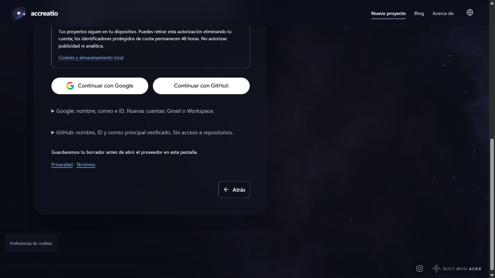
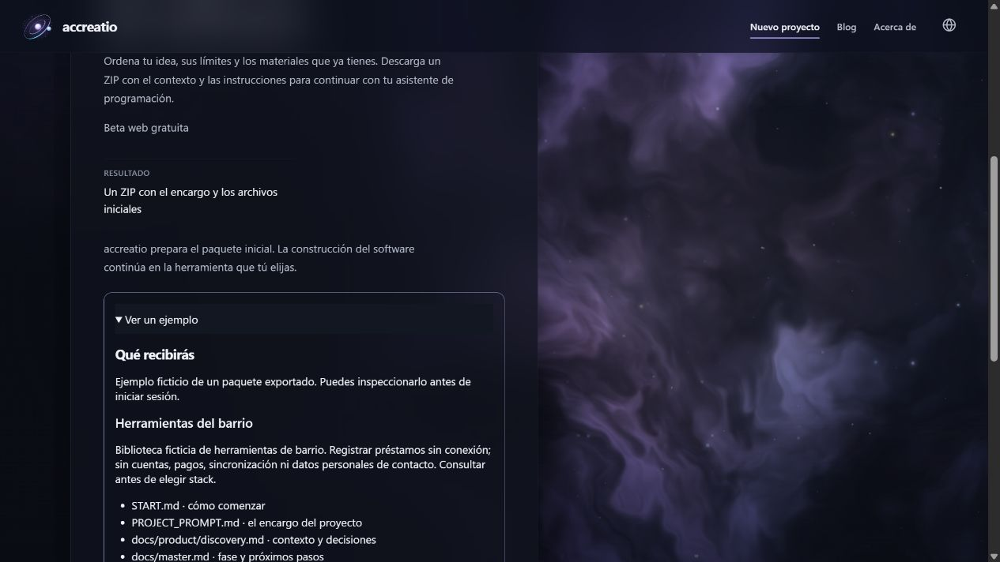
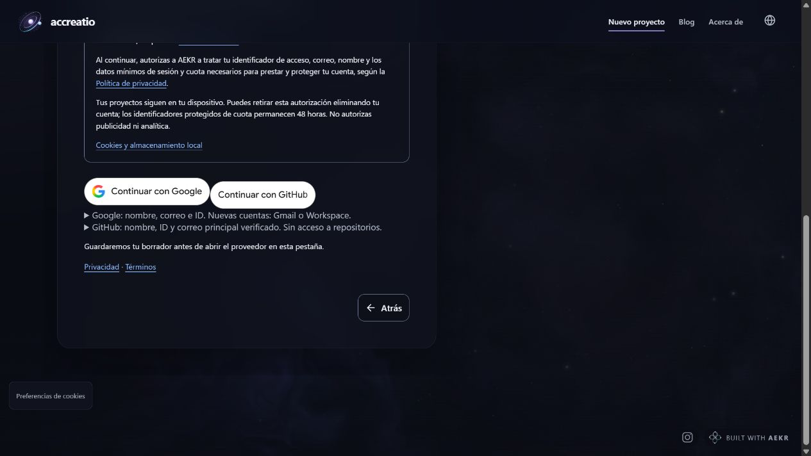

# accreatio 0.9.0 — actualización de implementación y despliegue

21 de octubre de 2026. **Origen: informe del equipo de implementación; no es una nueva auditoría independiente.**

**Estado global 0: NO COMPLETADO — EN CURSO O BLOQUEADO.** La versión 0.9.0 está desplegada en [accreatio.com](https://accreatio.com/), con readback público acotado PASS. Siguen pendientes OAuth real, exportación autenticada desde producción, Safari en iPhone físico y aceptación final de release. No se declara preview verificada ni el hito global de producción READY dentro del alcance completo.

[Versión HTML](update-2026-10-21.html) · [Snapshot factual del 20 de octubre](facts-only.md) · [Master histórico conservado](INDEPENDENT_REVIEW_MASTER_2026-10-20.md) · [Procedencia](updates/2026-10-21/update-provenance.json)

## 1. Procedencia y estado

Las cuatro revisiones y su master del 20 de octubre permanecen íntegros, con sus fechas y conclusiones. Esta actualización añade lo implementado y observado después; no reescribe capturas para aparentar que los defectos no existieron. Los hallazgos sobre 0.8.0 no se trasladan automáticamente a 0.9.0, ni los resultados locales del candidato a producción.

La base de la aplicación es `70612512e2115036fa71a08075a596a04bbff942`. El código actual de 0.9.0 es **`97f0b485c14374ebb9711015b8f2914578f83cb9`**, desplegado en producción. El pipeline final y el deployment vigente usan **`index-BO-vhWup.js`**, 488.442 bytes, SHA-256 `7fd03978c22af76fe65b3ad9020e82292899794019113f571160876e8e0e5470`. El commit documental final es `20e5053f3d0a41c10cbef2e561fa3b2949703683`, con el mismo código de aplicación. El readback público de producción confirmó el mismo tamaño y hash local; la preview autenticada continúa bloqueada por Access. No se publica código privado, logs privados, credenciales ni datos de cuentas.

El código anterior `0dec26d9fc299e8612b32fd8b93f090361cc25cc`, su commit documental `e72116f640c86c785eda40766bc847f7f7213e08` y el despliegue `3027a9b5` constituyen el **primer hito de producción**, preservado en el [historial de releases](updates/2026-10-21/release-history.json). Usaban `index-CbFRb9nV.js`, 488.184 bytes, SHA-256 `b3007c5b6cc7f106cda2b1bdf8df51d17b6f86ca074750351e4d82413456c5b7`. El candidato actual añade el ajuste de botones y una corrección del verificador de muestras, con su propio pipeline y recibo de despliegue; no se le atribuyen los resultados anteriores por igualdad de versión.

El pipeline integrado final `npm run verify`, sobre **97f0b485**, terminó con **exit 0 y 355/355 pruebas PASS**. Su recibo canónico comenzó a las 16:04:47 UTC del 21 de octubre. Esto acredita esa ejecución local, sin sustituir las rondas reales de identidad, la exportación autenticada de producción ni la aceptación humana. El pipeline anterior de 0dec26d se conserva como evidencia histórica separada.

Últimos hitos demostrados: verificación local completa, migración aislada de cuenta de preview, despliegues reconocidos y despliegue de producción con readback público acotado. **No se ha alcanzado el hito 2, PREVIEW VERIFICADO, ni el hito global 3 de readiness completa.** El propietario autorizó explícitamente desplegar en el dominio .com; esa autorización ya se ejecutó y no está pendiente.

## 2. Producto y recorrido

accreatio organiza una idea, sus límites y materiales en un encargo y un ZIP para continuar con un asistente de programación. El navegador genera el paquete de forma determinista, sin inferencia de modelos ni claves de IA. El producto no construye por sí solo la aplicación descrita. El servicio de cuenta y cuota sigue separado del contenido local del proyecto.

| Área | Cambio implementado localmente | Límite |
| --- | --- | --- |
| Preparación básica | Cinco preguntas: nombre, fase, idea, límites y revisión; discovery añade adjuntos como sexta pregunta. Generalista, ruta local y orquestación desactivada inicialmente. | Roles describen trabajo futuro, no agentes disponibles o ejecutándose. |
| Opciones avanzadas | Equipo, ruta, guías y orquestación se ajustan desde revisión. | Stack, presupuesto y aprobaciones no se inventan. |
| Revisión | Idea y límites completos; roles, ruta, orquestación, guías, entrega y adjuntos visibles. | Los detalles técnicos siguen disponibles como referencia desplegable. |
| Acción | Una elección en revisión: comprobar sin descargar o crear y descargar ZIP. El diálogo final confirma esa elección. | La comprobación sale antes de crear ZIP y no consume autorización nueva. |
| Continuación | START, instrucción compartida ES/EN y edición para otra exportación. | Solicitar una descarga no prueba que el archivo se guardó físicamente. |
| Reintento | Mismo ZIP retenido y recibo real de autorización de 48 horas. | Requiere que el ZIP permanezca en la pestaña y el recibo siga vigente. |

## 3. ZIP y primer uso

START dirige primero a AGENTS, PROJECT_PROMPT, discovery y master. AGENTS es canónico; CLAUDE es un adaptador corto y CODEX un puntero manual, sin afirmar carga automática universal. El master contiene Status, fase y perfil Lean, con preguntas pendientes explícitas.

El básico no requiere AEKR instalado, un checkout privado ni construir un orquestador. El avanzado incluye guías de configuración, runtime y gates con un único contrato `.ai-engineering/orchestration.yaml`. Su preparación es trabajo adicional sujeto a revisión humana. No se distribuye un runtime ni se considera seguro un script por generarse localmente. Se comprobaron referencias obligatorias y conservación de adjuntos.

| Ejemplo del generador real | Contenido | Acceso |
| --- | --- | --- |
| Básico ES | 21 archivos; proyecto ficticio y dos adjuntos; orquestación desactivada. | [ZIP básico](updates/2026-10-21/samples/accreatio-basic-sample.zip) |
| Avanzado EN | 27 archivos; proyecto ficticio, dos adjuntos y configuración opcional. | [ZIP avanzado](updates/2026-10-21/samples/accreatio-orchestration-sample.zip) |
| Procedencia | Fecha, versión, entradas y hashes del generador. sourceRevision registra la base; los hashes distinguen las fuentes modificadas. | [Manifiesto](updates/2026-10-21/samples/manifest.json) |
| Inicio | Misma fuente para ZIP, ejemplo y botón posterior a exportar. | [ES](updates/2026-10-21/samples/START.es.md) · [EN](updates/2026-10-21/samples/START.en.md) |

Un asistente aislado recibió solo cada paquete extraído, comenzó por START y produjo una propuesta útil del problema y un criterio observable de éxito, sin reparar el paquete ni elegir stack. En el avanzado conservó el plan de tres roles y dejó el runtime pendiente de revisión. Los documentos creados después de extraer son [resultado básico](updates/2026-10-21/handoff-basic-problem-proposal.md) y [resultado avanzado](updates/2026-10-21/handoff-advanced-problem-proposal.md). No representan software construido, agentes ejecutados ni aceptación humana.

La aplicación mantiene su licencia privada. Los avisos MIT de plantillas reutilizables se incluyen en los ZIP; no conceden derechos sobre la aplicación, las marcas o los adjuntos de terceros.

Después del primer despliegue se corrigió el verificador de ejemplos: `--check` reproduce el SHA de procedencia registrado en el manifiesto, validado como SHA de cuarenta caracteres, y recalcula los hashes de las fuentes actuales. Generar ejemplos sigue usando el HEAD del checkout. Así un commit posterior no cambia por sí solo la muestra que se está comprobando.

Las muestras vigentes registran `sourceRevision` `357d297e2c0ff1889d20e8449dcf4f78438fa1d4`. La comparación de ambos ZIP extraídos encontró una sola entrada diferente por paquete, `.accreatio/project.json`, y un único campo diferente, `sourceRevision`. El resto de las entradas, adjuntos, prompts, instrucciones y documentos R11 se conserva byte a byte; no era corrupción del ZIP. [Comparación saneada](updates/2026-10-21/examples-provenance-comparison.json). Las [muestras del primer despliegue](updates/2026-10-21/history/first-deployment-samples/manifest.json) se conservan por separado.

## 4. Borrador y recuperación

Respuestas, opciones, posición e idioma se guardan mediante un journal local inmediato e IndexedDB. Para adjuntos se conserva solo la cantidad, sin nombres ni bytes. Reseleccionar u omitir archivos exige una acción explícita. El borrador no es una copia de seguridad y no se sincroniza con la cuenta.

Se comprobaron recarga inmediata, último cambio y posición, Atrás/Adelante, retorno de estilo OAuth sin idioma explícito, errores de almacenamiento, dos pestañas y esquemas futuros. Se corrigieron precedencia del journal obsoleto, borrado desde pestaña obsoleta y versiones futuras. La interfaz distingue guardado confirmado de error y no anuncia recuperación que no ocurrió.

## 5. Identidad: implementado frente a habilitado

GitHub App se implementó para identidad de usuario, conservando Google y los IDs internos. El backend usa Authorization Code, PKCE S256 y state breve, de un solo uso y vinculado al navegador, proveedor, retorno y propósito. Comprueba la identidad con GitHub y emite su propia sesión revocable; no retiene el token del proveedor como credencial de cuenta.

Conectar un segundo proveedor es explícito desde la cuenta iniciada; coincidir en correo no fusiona cuentas. Los controles sensibles requieren nueva prueba ligada a la acción específica. Cuota y controles corresponden a la misma cuenta interna. Pruebas deterministas y UI sintética no equivalen a OAuth real.

Se configuraron Apps GitHub separadas para entorno controlado y producción: lectura de correo, sin permisos de repositorios u organizaciones. La configuración está habilitada en preview y el endpoint público de producción anuncia Google y GitHub disponibles, con OTP deshabilitado. Las Apps y secretos necesarios ya están preparados; no se requieren ni publican más credenciales para esta preparación. El flag de preview y la capacidad pública de producción no demuestran un login real operativo.

Para evitar escritores anteriores incompatibles se preparó un store de cuenta aislado de preview. El respaldo cifrado se restauró y las migraciones necesarias pasaron con igualdad de columnas originales, dos cuentas/dos identidades preservadas, sin backfill histórico de aceptación, integridad correcta y cero errores de claves foráneas. El cambio de binding de mantenimiento de preview fue desplegado; no constituye una preview de la aplicación verificada. En producción se conservó el store existente y se aplicó la migración aditiva 0006, según el recibo de la sección siguiente. No se publican identificadores privados de infraestructura ni datos de cuentas.

La API de administración reconoció el despliegue `176390b5-2148-4010-8bac-de88f2b592c9`, etapa de despliegue `success`, el **21 de octubre de 2026 a las 15:45:12 UTC**, y confirmó el SHA del código y el binding al nuevo store aislado. Direcciones: [deployment de preview](https://176390b5.accreatio.pages.dev) y [alias controlado](https://google-oidc-preview.accreatio.pages.dev). Este readback corresponde al plano de administración, no al funcionamiento de las APIs de cuenta.

El smoke hosted está **BLOCKED por Cloudflare Access**, que requiere el acceso personal autorizado del propietario; ya se notificó esa acción. No se probaron OAuth real, capacidades de la aplicación ni el asset servido tras ese control. El equipo documentó una primera vista con UI antigua como estado de caché y no la contabiliza como evidencia del candidato 0.9.0. El reconocimiento de despliegue no sustituye el smoke autenticado pendiente.

## 6. Comunicación y arquitectura

La bienvenida permite inspeccionar un ejemplo antes del acceso. El copy ES/EN distingue preparación de proyecto terminado, cuenta remota de contenido local, roles de agentes y solicitud de descarga de guardado físico. FAQ, About, navegación y notas históricas del Blog se reconciliaron, preservando fechas y autorías. Electron se describe como desarrollo congelado.

El propietario aprobó los textos y versiones `2026-10-21-privacy` y `2026-10-21-beta`, aplicados y presentes en el readback público de producción. Esto no representa revisión jurídica formal. Cookies opcionales y tratamiento necesario de cuenta siguen separados, sin aceptación histórica inventada.

La arquitectura conserva React/TypeScript/Vite, Cloudflare Pages/Functions y D1 separados para cuenta y Blog, con generación del ZIP en navegador. No se añadieron inferencia IA, pagos, suscripciones, sincronización de proyectos, acceso a repositorios ni telemetría. [Versiones declaradas del stack](updates/2026-10-21/stack.json).

### Ajuste posterior de botones Google/GitHub

El propietario observó que los botones estaban pegados y desalineados después del primer despliegue. El candidato posterior iguala sus dimensiones, alinea sus etiquetas y añade separación explícita; en pantallas estrechas los apila. El diagnóstico usó Edge real headless con capacidades y cuenta sintéticas, en Vite local: no fue una prueba de login ni de producción.

| Viewport | Dimensión observada de cada botón | Disposición y separación |
| --- | --- | --- |
| Escritorio 1280 px | Aproximadamente 250 × 44 px, ambos iguales. | Fila alineada, separación de 12 px. |
| 390 px | 262 × 44 px. | Apilados, separación de 12 px. |
| 320 px | 246 × 44 px. | Apilados, separación de 12 px. |

Las seis combinaciones ES/EN y viewport pasaron sin recortar etiquetas; los detalles quedan a 20 px de los botones. Son medidas de esos viewports emulados, no de teléfonos físicos. [Resumen saneado del diagnóstico](updates/2026-10-21/provider-buttons-summary.json).

Captura pública del deployment vigente `434eef0b`, observada en el navegador integrado. Confirma la presentación corregida de ambos botones en esa vista; no acredita OAuth real ni una sesión autenticada.

## 7. Verificación y límites

El pipeline local completo final, sobre 97f0b485, pasó con 355 pruebas, typecheck, formato, builds y sus smokes establecidos. Lighthouse informó rendimiento 96, accesibilidad 100, buenas prácticas 100 y SEO 69. El gate vigente admite noindex de la beta privada; no se presenta SEO 69 como un umbral de 90 superado. Su recibo se distingue del primer pipeline de 0dec26d. Esos indicadores no certifican accesibilidad completa, seguridad ni posicionamiento.

### Deployment vigente de producción: 434eef0b

El despliegue vigente **`434eef0b-6693-46c1-a789-d356d4b37e25`**, creado el **21 de octubre de 2026 a las 16:07:38 UTC**, terminó en `success` a las **16:07:42 UTC** en [accreatio.com](https://accreatio.com/). Usa el código **97f0b485** del pipeline final PASS. El readback de las **16:08:09 UTC** confirmó el mismo store de producción y:

- `./assets/index-BO-vhWup.js`, 488.442 bytes, SHA-256 `7fd03978c22af76fe65b3ad9020e82292899794019113f571160876e8e0e5470`, idéntico al bundle local final.
- [Ejemplo básico vigente](https://accreatio.com/examples/accreatio-basic-sample.zip), 19.635 bytes, SHA-256 `bbf72008cecfdf648718ba85c86f1e234e14877f2c5c2d33b56f21b2d9225b57`, idéntico a la muestra local regenerada. Esto no es una exportación de proyecto autenticada.
- Métodos con `no-store`: Google y GitHub disponibles, OTP deshabilitado; rutas públicas y avisos legales HTTP 200, con las mismas versiones aprobadas.

El navegador integrado confirmó los botones actuales alineados. No se hicieron cambios adicionales de D1 después de la migración aditiva 0006. La autorización para desplegar en .com ya se ejecutó; faltan las pruebas autenticadas y la aceptación final, no una autorización de promoción nueva.

Los recorridos usaron navegadores reales de escritorio y backend sintético: Edge, Firefox y WebKit de Playwright, ES/EN, teclado/foco/errores, revisión, descarga/reintento, rutas y viewports móviles emulados. El borde de campo medido dio 4,67:1 y se conservó foco visible. WebKit no acredita Safari en iPhone físico. [Resumen saneado](updates/2026-10-21/verification-summary.json).

La revisión independiente enfocada del diff informó siete hallazgos accionables —un P1 y seis P2— cerrados con correcciones y revalidación proporcionada. Su alcance era la fuente local y comprobaciones determinadas; no una aceptación de release. Este addendum resume ese resultado desde implementación, sin atribuirse independencia adicional.

El inventario npm informó cero vulnerabilidades high/critical y ocho moderate en la cadena retenida de desarrollo/escritorio, con versiones fijadas sin cambios. No es una auditoría integral de seguridad ni ausencia de defectos.

### Primer despliegue de producción: readback público acotado

El despliegue `3027a9b5-f62e-4f68-99eb-45731f06a630`, creado el **21 de octubre de 2026 a las 15:53:00 UTC**, terminó en `success` a las **15:53:03 UTC** en [https://accreatio.com/](https://accreatio.com/), con el mismo código `0dec26d9fc299e8612b32fd8b93f090361cc25cc` probado localmente. A las **15:53:54 UTC**, el readback público confirmó:

- JavaScript `./assets/index-CbFRb9nV.js`, 488.184 bytes, SHA-256 `b3007c5b6cc7f106cda2b1bdf8df51d17b6f86ca074750351e4d82413456c5b7`, idéntico al artefacto local de ese primer hito.
- Ejemplo básico leído en aquel despliegue, 19.635 bytes, SHA-256 `abb8a7bea2be1ee3630d6485e9e95003027870819c6f8e03f93d52e5a763a733`, idéntico a la [muestra local de ese hito conservada](updates/2026-10-21/history/first-deployment-samples/accreatio-basic-sample.zip). Descargar esa muestra pública no equivale a exportar un proyecto autenticado desde producción.
- Endpoint de métodos con `Cache-Control: no-store`: Google disponible, GitHub disponible y OTP deshabilitado. Esto comprueba la capacidad anunciada, no el flujo OAuth.
- Respuesta HTTP 200 en las rutas públicas comprobadas de About ES, Blog EN, privacidad, términos, cookies y manifiesto; versiones de avisos del 21 de octubre presentes.

El navegador integrado mostró la bienvenida actual, el ejemplo desplegado y los botones Google/GitHub, sin completar identidad ni aceptar por la persona. Un estado inicial antiguo del service worker se actualizó en la siguiente recarga sin borrar el borrador; esa primera vista antigua no se usó como prueba del candidato.

El respaldo protegido de producción fue restaurado en SQLite aislado y contrastado antes de aplicar 0006 al store existente. Se preservaron todas las columnas originales: dos cuentas, dos identidades, un recibo de política y un recibo de exportación; había cero sesiones y cero transacciones en ese corte. No se descifró PII ni se hizo reset o bifurcación del store de producción. El mantenimiento de producción conservó su cron compatible. Son resultados agregados de custodia y migración, no publicación de datos de cuenta.

Captura pública del primer despliegue de producción, antes del ajuste posterior de botones. Muestra la bienvenida y la muestra accesible antes de iniciar sesión; no demuestra creación autenticada ni utilidad de una aplicación terminada.

Captura pública del primer despliegue de producción, antes del ajuste posterior de botones. Muestra los métodos anunciados y el aviso de continuación; no demuestra OAuth real, vinculación de cuenta, aceptación humana ni consumo de cuota.

El smoke de preview sigue BLOCKED por Cloudflare Access, que no se retiró ni se evitó. Safari de iPhone físico también sigue BLOCKED. OAuth real y la exportación de un proyecto autenticado desde la UI de producción permanecen NOT RUN. Por ello el estado global continúa siendo 0.

## 8. Exportación de carga

Desde UI real se exportaron dos casos ficticios con Edge 155.0.4283.62, headless, Windows x64, 1440×1000 y movimiento reducido. Cuenta/autorización eran fixtures. El generador de producción creó el ZIP y el navegador lo descargó. Cada adjunto se extrajo y comparó byte a byte y por SHA-256.

Esta medición corresponde al bundle local anterior `index-CfNKP_Lr.js`, SHA-256 `d16e4a691f16942bb528002d00050ba9f1a325f19adb249909c2260f7357e673`. Sus bytes JavaScript difieren de CbFRb9nV y del candidato posterior BO-vhWup. Las fuentes del generador de paquetes usado por el navegador conservan sus hashes; el script de muestras cambió únicamente la reproducción de procedencia. La comparación de entradas conserva la correlación del contrato de exportación, **sin convertir estas cifras en una medición del frontend final**. El primer pipeline completo documentado se ejecutó sobre CbFRb9nV; el pipeline final PASS tiene su propio registro sobre BO-vhWup. Los tiempos funcionales anteriores, incluido el caso de recarga de 103 ms, conservan su recibo original y tampoco se atribuyen al frontend final.

| Caso | ZIP descargado | Generación | Confirmación hasta descarga y éxito | Respuesta durante generación |
| --- | --- | --- | --- | --- |
| 20 × 5 MiB = 100 MiB | 104.882.708 bytes; 20 adjuntos idénticos. | 372,9 ms | 807 ms | 38 ticks de 10 ms; intervalo máximo 17,0 ms; 22 frames; Tab confiable recibido en 2 ms. |
| Un archivo de 20 MiB | 20.989.774 bytes; adjunto idéntico. | 76,8 ms | 262 ms | 8 ticks; intervalo máximo 25,3 ms; 4 frames; Tab confiable recibido en 1 ms. |

Los límites exactos fueron aceptados; al llegar a veinte archivos se deshabilitó añadir más. Temporizadores, frames y teclado se observaron durante la creación real del ZIP. **No se midió código anterior: no se afirma mejora ni ausencia de regresión frente a otro baseline.** Es una medición de esta máquina y ejecución, no garantía para todos los dispositivos ni carga de producción. [Método, resultados y hashes saneados](updates/2026-10-21/export-load-summary.json).

## 9. Pendientes para cerrar readiness

### Matriz pública R01–R12

Esta matriz resume los criterios de readiness del candidato vigente y sus límites. Los PASS tienen el alcance indicado; no se suman para declarar aceptación global. Es una síntesis de implementación, sin una nueva auditoría.

| Criterio | Estado | Evidencia y límite pendiente |
| --- | --- | --- |
| R01 — Base, alcance, instrucciones y entornos | PASS | Candidato identificado; producción sirve los bytes del build final probado. |
| R02 — Referencias, contexto, fase, decisiones y adjuntos | BLOCKED | ZIP locales y muestras públicas fieles; falta el ZIP básico generado desde la UI autenticada de producción. |
| R03 — Básico autónomo y avanzado autocontenido | PASS | Paquetes reales ES/EN, procedencia, licencias, dependencias y configuración única comprobados localmente. |
| R04 — Identidad estable y proveedores | BLOCKED | PKCE/state, conexión explícita y regresiones locales; faltan OAuth real y enlaces autorizados. Preview sigue bloqueada por Access. |
| R05 — Google, cuota, controles y conservación | BLOCKED | Migraciones y preservación comprobadas; faltan cuenta, cuota y controles con proveedores reales. |
| R06 — Borrador, posición, adjuntos y multitab | PASS | Recarga, guardado y fallos locales comprobados en los navegadores declarados. No constituye backup entre dispositivos. |
| R07 — Revisión, acción, continuación y reintento | BLOCKED | Recorrido local y descarga/reintento real comprobados; falta completar el recorrido autenticado en producción. |
| R08 — Comunicación C01–C64 y ejemplo real | PASS | Copy ES/EN, muestra pública y avisos aprobados publicados. No equivale a revisión jurídica formal. |
| R09 — Accesibilidad y compatibilidad declarada | BLOCKED | Teclado, foco, contraste y viewports emulados comprobados; falta Safari en iPhone físico. |
| R10 — Rutas, recarga, callbacks y caché | BLOCKED | Pruebas locales y rutas públicas comprobadas; faltan callback/cuenta reales y preview tras Access. |
| R11 — Handoff aislado útil | PASS | Ambos paquetes produjeron una primera propuesta útil sin reparación; no sustituye el ZIP autenticado de R02/R12. |
| R12 — Release y criterios de aceptación | BLOCKED | Despliegue .com autorizado y ejecutado, bytes y custodia comprobados; faltan ZIP autenticado, controles reales y aceptación final. |

Resultado: **cinco PASS y siete BLOCKED; estado global 0, NO COMPLETADO**. La autorización para desplegar ya se ejecutó; no está pendiente una nueva autorización de promoción.

| Pendiente | Acción necesaria | Consecuencia |
| --- | --- | --- |
| Acceso personal a preview | Completar Cloudflare Access y ejecutar el smoke hosted del candidato exacto. | El smoke está BLOCKED; no hay readback verificado del asset ni de capacidades de la aplicación. |
| OAuth real | Rondas autorizadas Google/GitHub, conexión explícita y controles específicos. | Identidad real del candidato aún no acreditada. |
| Hosted | Desplegar y comprobar el mismo candidato en entorno controlado compatible. | No se declara preview verificada. |
| Producción autenticada | Completar identidad real, controles/cuota y preparar, descargar e inspeccionar un ZIP desde la UI autenticada. | El despliegue y readback público ya pasaron; esta prueba autenticada sigue NOT RUN. |
| Safari físico | Recorrer el flujo principal en Safari de iPhone real. | Emulación y WebKit no sustituyen este gate. |
| Release | Decisión humana explícita del propietario con evidencia. | Ningún agente o reporte se concede esa autoridad. |

El estado continúa siendo **0 — NO COMPLETADO**, aunque el pipeline y distintas comprobaciones locales estén en PASS.
