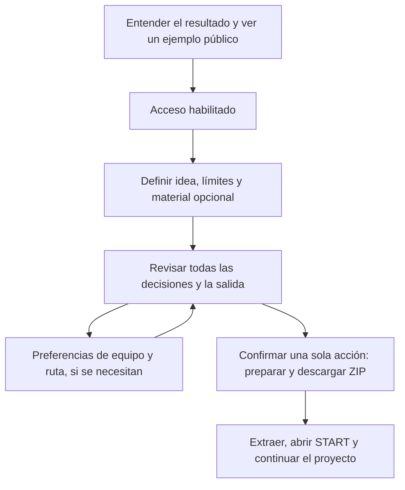

# accreatio — evaluación independiente de producto, diseño, flujo y comunicación

**Master de feedback · 20 de octubre de 2026 · America/New_York**  
Checkout local: `main` · `70612512e2115036fa71a08075a596a04bbff942` · versión declarada `0.8.0`.  
Web pública observada: [accreatio.com](https://accreatio.com/). Las evidencias UTC del 21 de octubre corresponden a la noche del 20 en Nueva York.

## Dictamen

**accreatio tiene una utilidad real como preparador de un encargo portable para continuar un proyecto. Su siguiente mejora debería concentrarse en hacer evidente ese valor y conseguir que la salida se sostenga por sí sola.** El creador hace preguntas comprensibles, permite revisar y produce un ZIP inspeccionable. La identidad visual es consistente. Sin embargo, el visitante todavía debe deducir para quién sirve, qué trabajo le ahorra y qué hará después de descargarlo.

El problema más concreto está dentro del resultado: el prompt pide dos documentos que no vienen en el ZIP y START dirige a construir un orquestador incluso en el recorrido básico con esa opción desactivada. Eso desvía la primera tarea hacia preparar herramientas. La mejora de mayor valor está en la correspondencia entre **promesa, decisiones solicitadas y primera acción útil después de exportar**.

La dirección recomendada es **preparar mejor el encargo, mostrarlo antes y facilitar su continuación**. Conservaría la marca, el tono tranquilo, la revisión y el procesamiento local del paquete. Reduciría los pasos sin una elección real, la jerga y el peso de las evidencias técnicas en las pantallas principales. Añadiría una muestra completa del resultado y un siguiente paso inequívoco.

## Cómo se hizo y qué significa independiente

Se crearon **cuatro agentes nuevos con contextos separados**, sin heredar el historial del chat. Recibieron su especialidad, el repositorio actual, la URL pública y las condiciones operativas de observación. No consultaron memorias, auditorías anteriores, documentos históricos de diseño ni los informes de los demás antes de cerrar el suyo. **AEKR no se usó como rúbrica, modo de evaluación ni argumento de aprobación.** Las menciones de AEKR visibles en el producto se evaluaron como contenido que recibe el usuario.

| Auditor | Responsabilidad | Informe independiente |
| --- | --- | --- |
| `audit_product` | Valor, público, alcance y utilidad de la salida | [01 · Producto](independent-review-2026-10-20/01-producto.md) |
| `audit_design` | Píxeles, jerarquía, legibilidad y estados responsive | [02 · Diseño visual](independent-review-2026-10-20/02-diseno-visual.md) |
| `audit_copy` | Propuesta, textos, terminología y consistencia ES/EN | [03 · Comunicación](independent-review-2026-10-20/03-comunicacion.md) |
| `audit_flow` | Primer uso, navegación, edición, revisión y entrega | [04 · Flujo](independent-review-2026-10-20/04-flujo.md) |

El coordinador consolidó y contrastó evidencias; no se cuenta como otro auditor independiente. Son agentes de esta misma sesión: el aislamiento evita heredar conclusiones, pero no representa diversidad de proveedores, una muestra estadística ni una auditoría humana externa.

Se observaron las pantallas públicas con Edge, sin iniciar sesión ni enviar información. Para los interiores se usó el frontend local con respuestas ficticias de cuenta/cuota interceptadas exclusivamente en localhost. El auditor de producto completó el recorrido y descargó un ZIP; los otros informes precisan hasta dónde llegaron. Se leyeron componentes, estilos y funciones actuales para contrastar lo observado. Los viewports visuales principales fueron 1440 × 1000 y 390 × 844 CSS px.

**Límites:** no se verificó el creador autenticado de producción, identidad, cuota real, aplicación Electron en ejecución, dispositivos físicos, Safari, accesibilidad completa, seguridad ni validez jurídica. No se estableció paridad exacta entre el despliegue público y el SHA local. No hay datos de conversión, abandono, retención ni ahorro de tiempo. Las recomendaciones sobre audiencia y simplificación son hipótesis razonadas; los errores de referencias y las discrepancias de texto tienen evidencia directa.

## Evaluación por dimensión

| Dimensión | Evaluación |
| --- | --- |
| Producto overall | Existe valor en ordenar y transportar contexto. La diferenciación frente a una buena plantilla todavía necesita demostrarse. El resultado actual es preparación documental, sin código de la aplicación solicitada. |
| Diseño de la página | Familia gráfica reconocible y creador bien jerarquizado. Las prioridades son delimitar controles, mejorar lectura y ordenar la entrada. La revisión no justifica cambiar toda la dirección artística. |
| Diseño del flujo | El recorrido se completa y permite corregir respuestas. Hay pasos sin decisión útil, selección repetida entre simulación/descarga, revisión incompleta a primera vista y reanudación sin conservar posición. Una salida inmediata perdió el último texto en el caso local observado. |
| Escritura y mensaje | Las preguntas son más claras que la propuesta inicial. Hay instrucciones públicas desactualizadas, jerga interna y explicaciones de distintas superficies mezcladas. |

## Hallazgos que deberían orientar las decisiones

Las prioridades expresan orden recomendado de mejora. El impacto y esfuerzo son relativos; no son una estimación de presupuesto ni una declaración sobre el estado de un lanzamiento.

| ID | Prioridad | Hallazgo / propuesta | Base | Impacto / esfuerzo |
| --- | --- | --- | --- | --- |
| M01 | Inmediata | Hacer autocontenido el prompt: exige dos SOP ausentes del ZIP | ZIP inspeccionado y `shared/domain.ts:533–545`; Producto P0 | Alto / bajo–medio |
| M02 | Alta | El primer paso debe tratar el proyecto elegido; preparar orquestación debe depender de una elección expresa | START exportado y `shared/exportManifest.ts:49–109`, `:283–299`; Producto P1 | Alto / bajo–medio |
| M03 | Alta | Declarar público y resultado, y mostrar un ejemplo completo antes del acceso | Bienvenida pública; Producto P1, Comunicación C05, Diseño oportunidades | Alto esperado / medio |
| M04 | Alta | Actualizar ayuda de acceso y contextualizar el artículo histórico del Blog | FAQ prescribe OTP; acceso público observado ofrece Google; artículo describe lectura con Access; Comunicación C01–C02 | Medio–alto / bajo |
| M05 | Alta | Mejorar delimitación de entradas en estado neutro | Borde–exterior ≈1,48:1 en muestra local; Diseño V01 | Alto para baja visión / bajo |
| M06 | Alta | Preservar posición y proteger el último texto ante navegación inmediata; hacer visible el guardado | Atrás/Adelante salió del creador y volvió al paso 1; el texto recién escrito no se recuperó en el caso local. Flujo F3; `src/App.tsx:397–398`, `:625–645` | Alto / medio |
| M07 | Media | Simplificar el trayecto básico y distinguir revisión de descarga con acciones claras | Ocho preguntas para idea inicial, entrega web fija, revisión y confirmación; Producto P2 | Medio–alto esperado / medio |
| M08 | Media | Orientar el resultado hacia extraer, abrir y continuar; plegar inventario técnico | Captura de resultado y `OutcomePanel.tsx:130–215`; Producto P1 | Medio–alto / bajo–medio |
| M09 | Media | Mejorar lectura móvil del Blog y jerarquía del acceso | Justificación en columna ≈314 px; aviso de 11,9 px y Google a ≈906 px en muestra EN; Diseño V02–V03 | Medio / bajo–medio |
| M10 | Media | Alinear microcopy de recuperación y datos conservados | Adjuntos dice guardar nombres; serialización vacía la lista y guarda cantidad. Dry run ES dirige a Entrega; casilla está en Revisión. Comunicación C03–C04 | Medio / bajo |
| M11 | Posterior | Ajustar detalles de acabado: foco del H1, ZIP duplicado, plurales, ayuda pequeña e iconos sociales pendientes | Diseño V04–V05 y oportunidades; Comunicación C08 | Bajo–medio / bajo |

### Producto: el paquete debe ahorrar trabajo reconocible

La salida observada conserva el contexto y las restricciones, incluye instrucciones y permite inspección. Ese es un punto de partida válido. El público con mejor ajuste aparente es quien ya trabaja con un IDE y asistentes de programación y necesita preparar encargos repetibles. Esta es una hipótesis; no se observaron clientes reales.

El término **«plan determinista»** necesita concretarse. La vista actual describe crear la carpeta y preparar documentación/firma; no deriva un plan de implementación de la idea. No hace falta añadir un proveedor IA para corregirlo: se puede llamar **«Qué incluirá tu paquete»** o **«Pasos de preparación»** y presentar el alcance con honestidad.

Para aumentar valor, probaría una definición breve de **para quién es, problema, primera versión, exclusiones y resultado esperado**, dentro de una misma sección con ayudas opcionales. Las respuestas desconocidas deben seguir figurando como desconocidas. Añadir pantallas obligatorias para cada punto volvería a introducir parte del problema.

El paquete básico debería tener una instrucción inicial que funcione en una carpeta nueva. El kit de roles y orquestación puede ser una elección avanzada con requisitos visibles. El ZIP de prueba permite comprobar por qué esto importa: `PROJECT_PROMPT.md` remite a `toolkit/MASTER_SOP.md` y `toolkit/project-scaffolds/project-lifecycle/SOP.md`, sin incluirlos. START pide construir el orquestador, aunque el YAML opcional no está presente. Se verificaron los archivos; no se ejecutó la continuación en un IDE, por lo que sus posibles bloqueos son una consecuencia inferida.

### Diseño: conservar identidad y corregir legibilidad

El creador tiene una estructura estable: pregunta, ayuda, control y acción. La selección combina señales gráficas y marca; la adaptación móvil observada mantiene una columna sin desbordamiento horizontal en la muestra. La paleta oscura y lavanda, el símbolo orbital y los iconos de línea forman una familia coherente.

La corrección visual más concreta es el **contraste del límite de las entradas sin foco**. En la muestra, borde `#2b3246`, relleno `#0d1019` y exterior `#0f111b` dan aproximadamente 1,49:1 y 1,48:1. El texto del campo tiene contraste alto; son problemas distintos. Debe verificarse qué señal identifica el control y mejorarla con referencia al [criterio de contraste no textual de W3C](https://www.w3.org/WAI/WCAG22/Understanding/non-text-contrast.html), que exige 3:1 para la información visual necesaria para identificar controles/estados. Esta medición no certifica toda la interfaz.

En móvil, alinearía el Blog al inicio: la justificación estira espacios en párrafos largos. También incorporaría un índice o artículos individuales; la muestra actual apila tres textos completos en una página de unos 7290 px. En el acceso, reorganizaría las explicaciones y repeticiones: el aviso medido usa 11,9 px y la acción queda después del primer viewport. La posición o el tamaño por sí solos no prueban incumplimiento ni abandono; evidencian una jerarquía que merece probarse.

Usaría parte del espacio de entrada para una **muestra real de la salida**. Daría más legibilidad a ayudas que llegan a 10,5 px. Los perfiles sociales pendientes pueden retirarse de la superficie pública hasta tener destino; son imágenes sin acción, no enlaces rotos. Conservaría el foco semántico de los títulos, dando a su contorno una apariencia deliberada.

### Flujo: revisar todas las decisiones y poder retomar sin sorpresas

El auditor de flujo completó los ocho pasos de idea inicial, corrigió campos vacíos, volvió a respuestas anteriores, editó desde revisión, ejecutó la simulación y descargó otro ZIP local. Las respuestas se conservaron al usar los controles internos de vuelta y el prompt reflejó la edición. Esta es una base útil para mantener.

La revisión debería mostrar **todas las decisiones que afectan a la salida**. Hoy corta la idea a 220 caracteres y no expone límites ni ruta en el resumen principal; encontrarlos requiere desplegar el prompt. Los botones «Foundation» y «Context» cambian el vocabulario de las preguntas. Conviene mostrar idea expandible, límites, archivos, ruta y equipo, con edición contextual.

Simulación y descarga se eligen tanto en revisión como en confirmación. El resultado correcto de una simulación muestra `0/2` pasos completados y operaciones omitidas: explica lo que no se hizo, pero puede resultar difícil interpretar que la comprobación terminó bien. La opción inicial segura debe conservarse; basta elegir la acción en un lugar y explicar el resultado con claridad. La descarga directa ya es posible desde el diálogo: el desvío por un resultado de simulación no es obligatorio.

La reanudación necesita atención concreta. En local, recargar devolvió al paso 1 con datos anteriores. Desde la idea, Atrás del navegador salió a la página previa —`about:blank` en esa sesión— y Adelante regresó al paso 1. El último texto recién escrito no se recuperó; el auditor reprodujo la salida rápida dos veces sin esperar expresamente al guardado. La fuente difiere la escritura 500 ms. **El hallazgo se limita al último cambio seguido de salida inmediata; no implica pérdida de todo el borrador ni reproduce el servicio de producción.** Preservar posición, indicar «Guardando/Guardado» y resolver la salida durante un guardado pendiente facilitarían una reanudación fiable.

También renombraría acciones según su destino: el «Volver» superior abre la bienvenida; el inferior retrocede una pregunta. «Preparar otro ZIP» lleva a revisar el mismo proyecto. «Ver bienvenida», «Pregunta anterior» y «Editar y volver a exportar» anticipan mejor esas diferencias. En la segunda pantalla de bienvenida observada con sesión simulada, «Continuar con mi proyecto» sería un CTA más coherente que volver a anunciar acceso.

### Comunicación: hacer explícita la utilidad y mantener una sola versión actual

La voz calmada y las preguntas del creador funcionan. La frase que distingue roles planificados de agentes en ejecución también es valiosa. El sitio necesita decir antes **qué recibe la persona y cómo lo usará**, usando términos del usuario.

Hay divergencias concretas que corregir antes de pulir slogans: FAQ integrada con instrucciones de correo/código frente al acceso Google observado; artículo de agosto que afirma que leer el Blog requiere Access frente a su lectura pública actual; escritorio presentado como opción junto a una FAQ que lo describe congelado. El Blog puede conservar su historia con una nota visible de vigencia. El visitante no debería reconciliar etapas del desarrollo para entender el producto actual.

La descripción de seguridad de About mezcla vocabulario de Electron —renderer, IPC— con la página web. Separaría el efecto para el usuario de los mecanismos técnicos y distinguiría las ediciones. En el acceso, explicaría una sola vez la relación entre accreatio y el operador AEKR; el título de los enlaces debería coincidir con el documento de destino. También debe aclararse «documento aplicable» frente a «borrador pendiente de revisión». El informe editorial no determina su efecto legal.

## Qué conservar, cambiar, quitar y agregar

| Acción | Recomendación concreta |
| --- | --- |
| **Conservar** | Marca y activos actuales; tono sobrio; preguntas comprensibles; un generalista inicial; personalización plegada; posibilidad de volver; revisión antes de exportar; ZIP inspeccionable; límites explícitos sobre agentes y descarga. |
| **Cambiar** | Punto de entrada del ZIP; precisión del «plan»; propuesta inicial; consistencia de acceso/ayuda; jerarquía del acceso; delimitación de campos; lectura del Blog; entrega centrada en continuar. |
| **Quitar del trayecto básico** | Mandato de construir un orquestador; pasos con salida fija y sin elección útil; jerga sin explicar; inventario técnico expandido como contenido principal; enlaces repetidos e iconos de perfiles pendientes. «Quitar» significa retirar o plegar en esa superficie, sin borrar historia ni perder capacidades especializadas. |
| **Agregar primero** | Ejemplo público identificado como ejemplo; vista del prompt y árbol real de archivos; ZIP de muestra; una instrucción de continuación autocontenida; campos opcionales de primera versión/exclusiones/éxito. |
| **Evaluar después** | Importar o actualizar un encargo anterior; plantillas por tipo de proyecto; mejor navegación editorial. Su valor requiere observar usos reales. |
| **Posponer** | Chat propio, AI alojada, colaboración cloud y más integraciones: hoy no resuelven las fricciones mejor sustentadas de este informe. |

## Propuesta de mensaje y recorrido

Las siguientes frases son candidatos para probar, no texto aprobado ni capacidades nuevas.

> **Prepara el encargo de tu próximo proyecto de software.**  
> Ordena tu idea, sus límites y los materiales que ya tienes. Descarga un ZIP con contexto e instrucciones para continuar en tu IDE.  
> **Ver un ejemplo** · **Preparar mi proyecto**

«Software» expresa una opción de posicionamiento, pendiente de decisión del propietario. Si se busca un público más amplio, hará falta demostrarlo con ejemplos y resultados de ese público. La presentación web debería anunciar su salida web y el acceso admitido; el escritorio necesita su estado explícito.

| Actual | Candidato más preciso |
| --- | --- |
| «Prompt explícito, plan determinista…» | «Tu definición, las instrucciones para continuar y los archivos del paquete»; mostrar el contenido concreto al lado. |
| «¿Quién trabajará en tu proyecto?» | «¿Cómo quieres repartir el trabajo después?»; mantener la aclaración de que no se ejecutan agentes. |
| «Fuentes de discovery» | «Archivos de apoyo». |
| «Ejecutar revisión seca» | «Revisar sin descargar» en web. |
| «Manifiesto de entrega» | «Qué incluye tu paquete». |
| «ToS» | «Términos». |
| Resultado dominado por estados y rutas | «Abre Descargas, extrae el ZIP y empieza por START.md»; esta frase debe acompañar la corrección de START. |

Recorrido candidato, conservando por ahora el acceso previo al creador:

Agrupar preguntas reduce interrupciones y puede aumentar densidad en móvil: hacen falta ayudas y campos opcionales bien presentados. Al plegar equipo/ruta, sus valores deben seguir visibles en revisión. La edición, la vista previa y la opción segura permanecen disponibles; la posición y el guardado deben poder recuperarse.

Mover el acceso hacia la exportación es una **alternativa de producto que requiere evaluación**, no un acuerdo de los cuatro auditores ni una instrucción para alterar controles. Mostrar un ejemplo completo antes del acceso tiene apoyo convergente y permite avanzar sin resolver todavía esa decisión.

## Orden recomendado de mejora y cómo comprobarlo

1. **Corregir integridad y coherencia:** resolver referencias ausentes, hacer que START respete la elección de orquestación, proteger la salida con guardado pendiente y actualizar acceso/FAQ/Blog y microcopy de recuperación. Comprobar el paquete en una carpeta vacía, probar navegación inmediata y comparar las instrucciones entre pantallas.
2. **Probar una promesa más concreta con una muestra:** una persona ajena debería explicar qué recibe, qué no recibe y qué necesita después sin iniciar sesión ni abrir toda la FAQ. No se ha fijado un porcentaje de éxito porque falta una línea de base.
3. **Simplificar decisiones y continuación:** probar el recorrido propuesto frente al actual, observar dónde se detiene la persona y si logra empezar con el ZIP. Separar tiempo de rellenar, espera de acceso y tiempo de continuar el proyecto.
4. **Corregir legibilidad y acabado:** verificar entradas en estados neutro/foco/error, Blog móvil, jerarquía del acceso y objetivos de ayuda en los viewports actuales. Ampliar a teclado, zoom y dispositivos reales antes de afirmar accesibilidad general.
5. **Validar la utilidad del núcleo:** comparar un encargo real con una plantilla Markdown simple; comprobar qué decisiones quedaron más claras y qué parte se reutiliza al día siguiente. La observación consentida con notas es suficiente para comenzar; esta propuesta no implica añadir seguimiento de usuarios.

**Decisiones aún abiertas:** audiencia primaria; paquete básico portable frente a kit metodológico especializado; ubicación del acceso; disponibilidad que se desea ofrecer públicamente para escritorio. Son decisiones de producto. El funcionamiento de un ZIP ni el consenso de agentes las resuelven por sí solos.

## Evidencia y alcance de la entrega

Los cuatro informes anteriores conservan el razonamiento de cada auditor y sus evidencias detalladas. Una selección reproducible está en [evidencia y procedencia](independent-review-2026-10-20/EVIDENCE.md), incluyendo:

- [Bienvenida pública, escritorio](independent-review-2026-10-20/evidence/public-welcome-desktop.png).
- [Acceso público, móvil](independent-review-2026-10-20/evidence/public-access-mobile.png).
- [Campo del creador, cuenta ficticia](independent-review-2026-10-20/evidence/local-builder-desktop.png).
- [Blog público, lectura móvil](independent-review-2026-10-20/evidence/public-mobile-blog-reading.png).
- [Resultado local, cuenta ficticia](independent-review-2026-10-20/evidence/local-output-fixture.png).
- [Inventario y textos del ZIP](independent-review-2026-10-20/evidence/zip-inspection.txt) y [ZIP ficticio examinado](independent-review-2026-10-20/evidence/huerto-comunitario-sample.zip).

El ZIP examinado contiene 17 entradas, 59.261 bytes de contenido sin comprimir; el archivo ocupa 62.231 bytes. SHA-256: `1E24BF0320113C13139EAFF9063579A8DF3F7DA794641BB144B445DAC98F0590`. Es una muestra local con datos inventados, no un proyecto de un usuario ni una prueba del backend desplegado.

Esta entrega contiene evaluación y propuestas. No se implementaron cambios de producto ni se modificaron cuentas, publicaron textos o realizaron despliegues. El archivo `PRIVACY.md` ya estaba sin seguimiento al iniciar y se preservó sin leerlo ni modificarlo. La verificación de esta entrega consiste en recorridos observados, lectura del ZIP, contraste de fuentes y comprobación de documentos/evidencias; no se presenta como una nueva ejecución de la suite técnica del producto.
