# Seguridad, identidad y entrega web de accreatio

Actualización consolidada del 22 de octubre de 2026

**Estado:** Entrega cerrada; recibos finales incluidos.

[HTML](update-2026-10-22.html) · [Procedencia](updates/2026-10-22/provenance.json) · [Auditoría independiente](updates/2026-10-22/independent-audit-summary.json)

## Estado de esta entrega

Entrega técnica completada y desplegada en accreatio.com. Este documento reúne los cambios de diseño, seguridad y ciclo de vida realizados el 22 de octubre y separa la auditoría independiente de baseline, las comprobaciones locales y la evidencia del servicio publicado.

Fuente final y merge de producción: e239ccb8bd8c9f3f715f6937eceaa685e1cee2bb. Deployment Pages: febdda0b-d860-4bf3-9cfc-48a123a72676. El recibo final comprueba 13 artefactos públicos: 12 coinciden byte por byte; el HTML coincide tras normalizar una única inserción esperada de seguridad de Cloudflare Bot Fight Mode. No se declara igualdad binaria del HTML.

Cadena de entrega: implementación e30c6983b7df569ff50af81865e7e865500b8048; ejemplos fe8c14abb4a3d66e22acb1d732c998f9a1694db1; PR 10 fusionado en a2fe8edee6358f5618b1013feb57d6fb7958a5c7; ajuste final de cuatro archivos UI/FAQ/documentación 232aa939af7a597a0b3fb0e5eaa6c943dd37c2d7 y PR 11 fusionado en la revisión final. La corrección de copy elimina las antiguas listas de formatos y refleja la política de validación real.

Recibo documental en main: ec742854340550ac315bae689bd22152067912ce, guardado y publicado después del despliegue. Es un commit de recibo; la revisión de ejecución desplegada sigue siendo e239ccb8bd8c9f3f715f6937eceaa685e1cee2bb.

El cierre técnico no implica aceptación humana/UAT ni una certificación de seguridad absoluta. GitHub Actions no llegó a iniciar sus jobs por restricciones de billing/spending de la cuenta; no se aplicó ningún cambio de pago. Las comprobaciones locales y el despliegue tienen recibos separados.

## Identidad y diseño aceptados

Los recibos de diseño de hoy son históricos respecto al candidato de seguridad final: fuente 82b9ac3b y despliegue 0c32f01a para el primer perla; fuente a7394402 y despliegue 862e26ff para el pulido. El recibo de abuso posterior registra fuente 73e2288d y despliegue 2c2558a5. No se transfiere automáticamente un resultado anterior al nuevo código.

| Área | Cambio y procedencia |
| --- | --- |
| Respaldo previo | El diseño anterior quedó preservado en el repositorio privado: commit 236748f y docs/design-backups/2026-10-22-pre-iceland/. El archivo fuente no se publica aquí. Su hash y las capturas anónimas conservan la procedencia. |
| Logo oficial | Se usa el PNG seleccionado por el propietario, con símbolo y lettering originales, recortes y escalado deterministas. SHA-256 del original: 0c53ade5c085e5867541ab933a53288b35e8157f9b1e7698c6536725e5a4b71a. No se redibujó ni generó otra identidad. |
| Paleta | Fondo perla islandés mate #E8EAE7; títulos carbón #303235; acentos limitados rojo #E2232A; texto #515852; subtexto #5E655E. La tipografía se mantiene y perla es el tema por defecto. |
| Nebulosa y tema oscuro | La nebulosa procedural tiene mayor densidad y contraste mineral. Los contornos del logo original se conservan mediante filtros SVG nativos de alfa/color, con fondo transparente en oscuro y punto rojo. |
| Pestaña y Blog | Favicon derivado del símbolo oficial. Título corto y estable: accreatio \| sección, en el idioma activo. En el cabecero del Blog sólo Blog va en rojo; no se añadió otro logo. |
| Alineación global | Revisión de botones, textos, roles, controles de copia/descarga, revisión, diálogos, About y páginas legales. Cookie preferences comparte y alinea la fila de Instagram y AEKR; controles con áreas de interacción de al menos 44 px en las vistas comprobadas. |

## Protecciones de cuenta y privacidad entregadas hoy

El recibo previo de esta implementación registra 423 pruebas locales y readback de 28 archivos públicos. Son resultados de aquella fuente, no una auditoría completa ni prueba de la corrección posterior. La nueva configuración de edge descrita aquí supera la limitación de permisos del recibo anterior.

Los avisos 2026-10-22b-privacy y 2026-10-22b-beta ya están desplegados y reflejan contenido activo, entrega sólo web y protección edge/cookies de seguridad. El propósito sigue siendo account-core-v1; no se fabrica ni se retrofecha aceptación histórica.

- Presupuestos atómicos por ruta, red, cuenta y sesión; HTTP 429 y Retry-After. El guard de la aplicación conserva HMAC de red y estado técnico mínimo, sin IP cruda, email, user-agent, contenido del proyecto o cuerpo de petición.
- Tres episodios de exceso elegibles y atribuibles en diez minutos pueden restringir temporalmente una cuenta por diez minutos; recurrencias escalan a una hora y hasta 24 horas. No hay cierre permanente automático ni sanción por compartir IP o utilizar otro email.
- Acceso independiente y verificado a descarga/borrado de datos propios, con prueba de cinco minutos y cookie distinta. No exige aceptar nuevos Terms para ejercer estos derechos y no concede acceso ordinario al creador.
- Terms, aviso de privacidad e inventario de almacenamiento necesario actualizados. Las preferencias de cookies siguen separadas de la autorización necesaria de cuenta.
- Publicación sin source maps, control de artefactos publicados y HSTS de un día en respuestas estáticas/API. El código que recibe un navegador continúa siendo inspeccionable.
- Migraciones aditivas 0007 y 0008 aplicadas a producción y al almacén aislado de preview; estado de cuenta, cuotas, autorizaciones e identidades preservados. Mantenimiento horario con limpieza acotada.

## Auditoría independiente: dos hallazgos confirmados

El scan 381e927b-528f-4962-88f9-4aee8c91eccd quedó sellado sobre c2235dccf759da2ff106d84d63a8496a5befcc65. La cobertura es parcial: 104 archivos revisados íntegramente de un inventario de 610; otros se buscaron o inspeccionaron selectivamente. Esa relación no representa un porcentaje de seguridad.

Revisores nuevos separaron arquitectura, fuente y navegador. La navegación pública observó 45 respuestas GET, sin login, mutación ni ataques de carga. Los ensayos de DOM y ZIP y las reproducciones de validación se ejecutaron de forma aislada, con autorización sintética cuando correspondía.

| Severidad y alcance | Confirmación | Tratamiento posterior |
| --- | --- | --- |
| Media · web · CWE-1333 | Una validación de slug del Blog podía consumir CPU excesiva y congelar la pestaña al abrir una URL manipulada. No se confirmó compromiso de servidor, cuenta o datos. | Validador compartido con longitud explícita y expresión lineal para URL y respuesta de API; regresiones en ambas entradas. |
| Baja · prototipo local nunca publicado · CWE-426 | La búsqueda de un ejecutable por nombre desde una carpeta local existente podía seleccionar un binario de esa carpeta en Windows. Requería uso deliberado del prototipo y contenido local controlado por un tercero. | Retiro definitivo del escritorio; comandos documentados de desarrollo, build, prueba y empaquetado fallan con una razón explícita. La web no expone esa ejecución privilegiada. |

- Los caminos examinados no aportaron una explotación confirmada de SQL injection, XSS, IDOR, CSRF, apropiación de cuenta o escape de rutas del ZIP. No significa ausencia universal de esas vulnerabilidades.
- En el ensayo local, contenido HTML hostil permaneció inerte y los nombres de archivos del ZIP quedaron normalizados bajo su raíz sin escapes ni colisiones.
- Se observó un fallo de robustez al alterar el almacenamiento propio del navegador; no se estableció una entrada controlada remotamente ni ejecución de código.
- No se publican enlaces de explotación, binarios de prueba, credenciales, datos personales ni archivos hostiles. El resumen público deriva de los artefactos sellados y no reemplaza ni modifica el informe canónico.

## Adjuntos: Word, PDF e imágenes, con controles reales

La política admite exclusivamente DOCX, PDF, PNG, JPG y JPEG. Quedan fuera DOC, DOCM, SVG, scripts, ejecutables, archivos comprimidos, JSON, TXT, MD, YAML, CSV y extensiones no permitidas. Renombrar un archivo no lo convierte en válido.

El selector y la frontera final de ejecución web inspeccionan contenido real en un Worker desechable del mismo origen, con terminación a los diez segundos. Sólo el Blob reconstruido e inmutable, asociado a su nombre exacto mediante una prueba privada en memoria, puede entrar al ZIP. Un Blob nuevo o un cambio de nombre no hereda esa prueba. Las llamadas directas al bridge vuelven a pasar la inspección antes de conservar el ZIP, pedir cuota o descargarlo.

Los límites existentes siguen siendo 20 archivos, 20 MiB por archivo y 100 MiB por selección; se vuelven a comprobar usando los tamaños reconstruidos. Tras el proceso asíncrono se revalida la cuenta, generación del espacio de trabajo y estado de adjuntos. Los borradores restaurados requieren volver a seleccionar sus archivos.

Los contenidos permanecen en el navegador. No se suben al servidor, a un servicio antivirus ni a un proveedor de IA. Los formatos complejos que quedan fuera del subconjunto admitido se rechazan de forma explícita.

La política y su Worker reconstruidor están desplegados en la revisión final indicada arriba. La interfaz, About y FAQ usan ahora la misma lista de formatos y explican la inspección real; el ajuste final fue de copy, con sus comprobaciones afectadas y build propios.

| Formato | Inspección y reconstrucción |
| --- | --- |
| DOCX | Parseo acotado de ZIP/OPC, CRC, nombres, rutas, expansión y XML/relaciones. Rechaza macros, OLE, objetos, campos activos, relaciones o plantillas externas, DTD/entidades y partes no admitidas. Reconstruye el paquete y sus imágenes PNG/JPEG. Enlaces externos y funciones complejas de Word pueden ser rechazados deliberadamente. |
| PDF | Parseo de objetos, streams y nombres codificados, incluidos object streams comprimidos; reescritura del documento. Rechaza cifrado, scripts, acciones activas/automáticas o remotas, archivos embebidos, formularios/XFA, rich media y codecs no admitidos. Admite navegación interna estática y enlaces HTTPS. PDF 1.0–1.7; PDF 2.0, predictors y combinaciones no admitidas fallan de forma cerrada. |
| PNG/JPEG | Firma y dimensiones comprobadas, decodificación real y exportación a bytes nuevos mediante canvas. Sin fallback al original. Conserva transparencia PNG y orientación decodificada; elimina metadatos y sufijos añadidos. No preserva animación. Sin Worker, bitmap decoding u OffscreenCanvas compatibles, se rechaza. |

- Límites de imágenes: 16 millones de píxeles y 8.192 píxeles por dimensión. DOCX: 512 entradas, 32 MiB de expansión total, 4 MiB por XML, profundidad 64 y 50.000 nodos XML.
- Límites PDF: 8 MiB por stream Flate, 32 MiB acumulados decodificados, 2.000 páginas, 20.000 objetos indirectos, 100.000 objetos parseados y profundidad 64. La validación de estructura antecede operaciones de alto nivel que podrían expandirla.
- Es admisión estricta de contenido activo y reconstrucción, no un antivirus general ni garantía frente a vulnerabilidades desconocidas de lectores. Los enlaces HTTPS siguen siendo destinos no confiables y el texto plano puede contener instrucciones; los agentes posteriores deben tratar los adjuntos como referencia no confiable.
- Los documentos/configuraciones controlados que genera accreatio y los JSON de derechos de cuenta son salidas de producto separadas de los adjuntos de terceros. accreatio no aloja ni distribuye el ZIP de un usuario a otro.

## Sólo web; escritorio obsoleto y nunca publicado

Decisión expresa del propietario: el prototipo original de escritorio es obsoleto, no fue publicado y nunca se publicará. La entrega presente y futura es exclusivamente la web/PWA; About publicado refleja esa decisión.

Los comandos por defecto y verify pasan a la entrega web. Las entradas npm documentadas de escritorio fallan de forma cerrada; se retiraron del árbol de desarrollo las dependencias de Electron y empaquetado. Se conserva el código histórico y su procedencia, sin redistribuirlo como producto o candidato de release.

Los recibos de pruebas y paquetes locales de comienzos del día se conservan como historia. No prueban un lanzamiento de escritorio ni autorizan reactivarlo.

## Protección contra bots y ráfagas: ya aplicada en Cloudflare

Los contadores de edge son distribuidos y la mitigación puede tener demora. No constituyen un techo global exacto ni hacen imposible todo DDoS. Una red compartida con una ráfaga elevada puede recibir el bloqueo breve; esto no sanciona la cuenta ni compara emails.

Los controles de zona no cubren los aliases separados pages.dev. En el readback final, accreatio.pages.dev y el alias del deployment respondieron 302 hacia Cloudflare Access antes de llegar a Functions. La lista exacta de hosts API, con rechazo temprano antes de D1, está probada localmente e incluida en la fuente desplegada. No se observó una denegación de ese guard en producción detrás de Access y no se afirma un 403 en esos aliases. Un rechazo que alcance la Function todavía consume invocación y no elimina cada coste de cuota de plataforma.

Bot Fight Mode no admite excepciones Skip mediante reglas WAF y puede desafiar automatización legítima. Las políticas de IA no identifican necesariamente a todo agente adversarial, navegador controlado o proxy rotatorio. Robots.txt es una preferencia, no un bloqueo técnico.

| Control | Estado guardado y reabierto |
| --- | --- |
| Coste adicional | Plan de zona Free, sin upgrade ni suscripción nueva. |
| Bot Fight Mode | Activado; desafíos frente a patrones reconocidos de bots en todo el dominio. |
| Agentes y entrenamiento de IA | Agent: Block en todas las páginas. Training: Block en todas las páginas. Search: Allow. Se aplican clasificaciones de comportamiento, sin selección por un único proveedor. |
| Ráfagas por IP | Regla activa: 100 peticiones en 10 segundos; Block durante 10 segundos. Ruta /*, incluidos estáticos, HTML y API; sin exclusiones de callbacks o derechos que permitan eludirla. |
| DDoS | Protección HTTP administrada siempre activa, preservada. El proveedor documenta mitigación automática L3/L4/L7 en todos los planes. |
| Comprobación | Regla reabierta con umbral, duración y estado correctos; políticas de bots reabiertas después de recargar. Home y Blog públicos siguen cargando en el navegador integrado. |

- [Cloudflare: Bot Fight Mode](https://developers.cloudflare.com/bots/get-started/bot-fight-mode/)
- [Cloudflare: AI bot policies](https://developers.cloudflare.com/bots/additional-configurations/block-ai-bots/)
- [Cloudflare: rate limiting](https://developers.cloudflare.com/waf/rate-limiting-rules/)
- [Cloudflare: DDoS protection](https://developers.cloudflare.com/ddos-protection/about/)

## Verificación y límites

El pipeline local verify completo pasó con 452 pruebas sobre la implementación e30c6983b7df569ff50af81865e7e865500b8048, incluidas 14 específicas de admisión/reconstrucción de adjuntos. Después se actualizaron ejemplos; el ajuste final de cuatro archivos UI/FAQ/documentación pasó 13 pruebas afectadas y un nuevo build web. Estos alcances se conservan separados para no atribuir una repetición completa de verify a la última corrección de copy.

El harness local del navegador integrado pasó 10/10 comprobaciones con fixtures sintéticos: imágenes reconstruidas, prueba de Blob no transferible, DOCX/PDF simples aceptados, contenido activo rechazado, SVG disfrazado rechazado y CSP sin infracciones. Lighthouse registró rendimiento 91, accesibilidad 100, buenas prácticas 100 y SEO 69 con la excepción deliberada de beta noindex.

El chequeo npm audit informó cero vulnerabilidades conocidas en su base de avisos y GitGuardian pasó. GitHub Actions falló antes de iniciar jobs por restricciones de billing/spending de la cuenta; no se describe como CI aprobada ni como fallo ejecutado de las pruebas, y no se cambió el plan de pago.

Una revisión independiente del candidato detectó dos problemas adicionales del parser PDF: expansión de una estructura de páginas compartidas y una referencia externa de stream. Ambos se corrigieron y el equipo añadió regresiones para validación previa a operaciones de alto nivel, nombres de claves codificados y conservación de flags ordinarios de anotaciones. La revisión posterior fue interrumpida por el filtro de seguridad de OpenAI; no se afirma un cierre independiente completo ni un dictamen limpio del candidato.

El readback final sobre e239ccb8bd8c9f3f715f6937eceaa685e1cee2bb pasó: 13 artefactos comprobados, 12 exactos y HTML normalizado por una inserción de seguridad del proveedor. Blog público 200, sesión anónima 401 y HSTS de un día. Los aliases pages.dev redirigen a Access con 302; eso no acredita la ejecución de una denegación del host guard.

No se realizó un ataque destructivo, flood, denegación de servicio deliberada ni borrado de cuentas reales. Los ensayos locales y el readback público no sustituyen una autenticación real del propietario, una prueba de derechos con identidad personal, Safari físico o una certificación exhaustiva de seguridad.

La comparación opcional con el checkout externo de AEKR quedó omitida porque esa copia no estaba disponible. Las comprobaciones locales fijadas de assets, payload y licencia pasaron. No se convierte ese salto opcional en una comparación externa ejecutada.

## Evidencia seleccionada

Capturas anónimas de producto y pantallas de configuración saneadas. Las imágenes de diseño corresponden al pulido de hoy; las de edge documentan la configuración guardada. El harness de adjuntos es local, con fixtures sintéticos y sin archivos de usuarios. El contenido histórico conserva su fecha.

[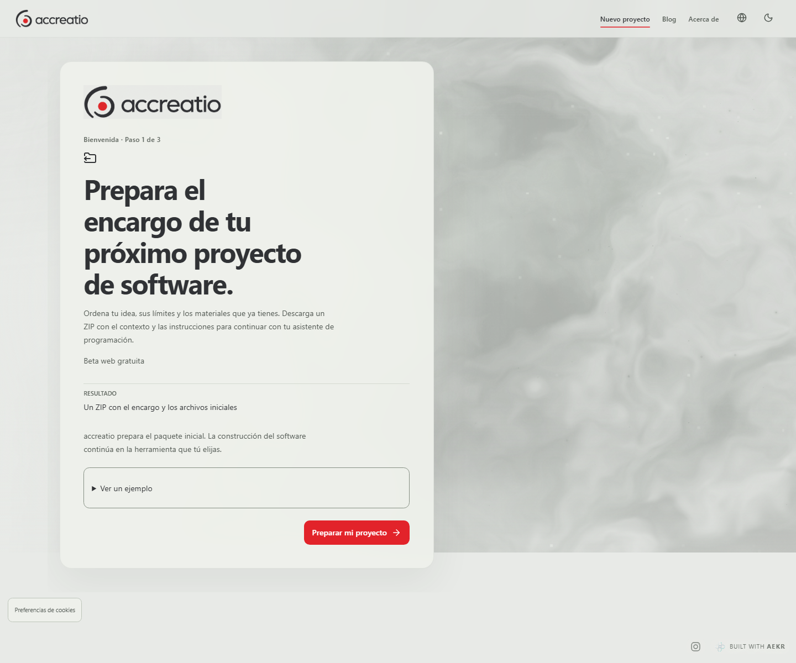](images/design-desktop-pearl.png)

Captura pública del pulido de diseño,22 de octubre.

[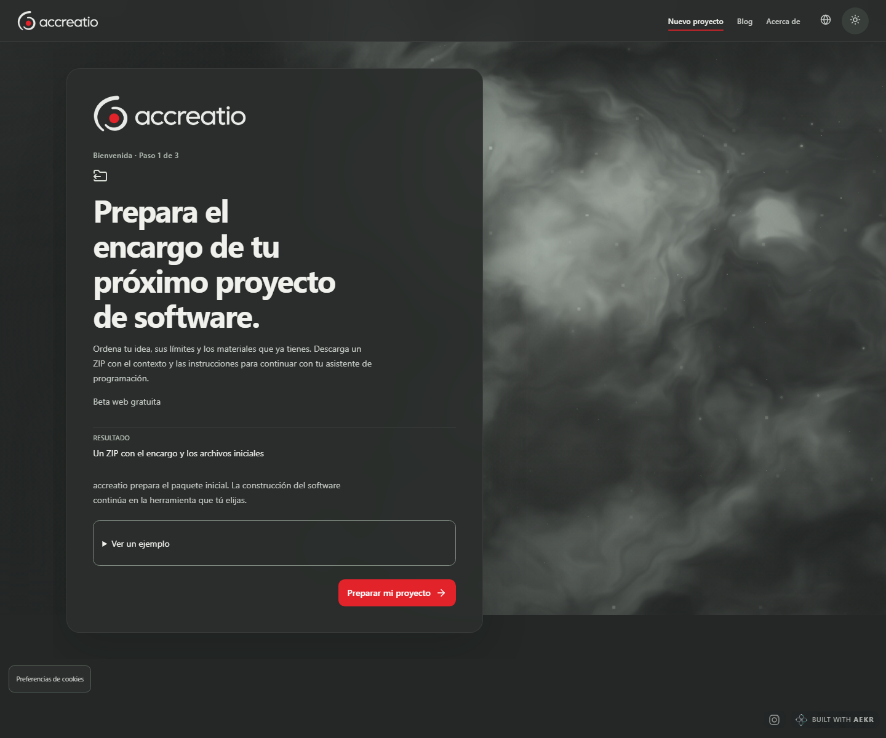](images/design-desktop-dark.png)

Captura pública del pulido; contornos originales preservados.

[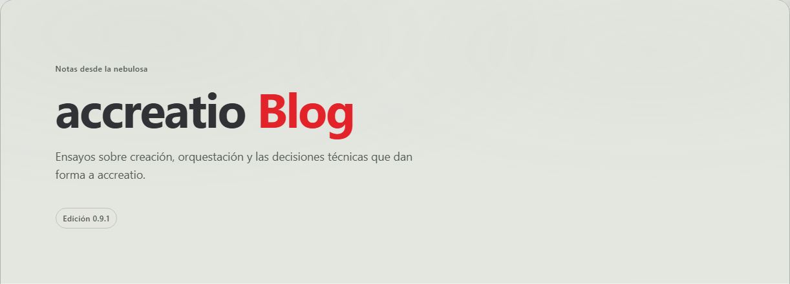](images/design-blog-red.png)

Cabecero final aceptado, sin logo adicional.

[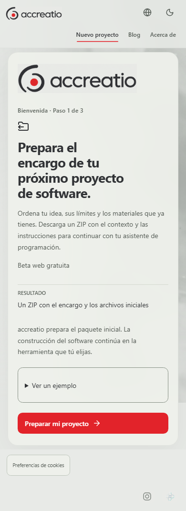](images/design-mobile-pearl.png)

Captura pública anónima.

[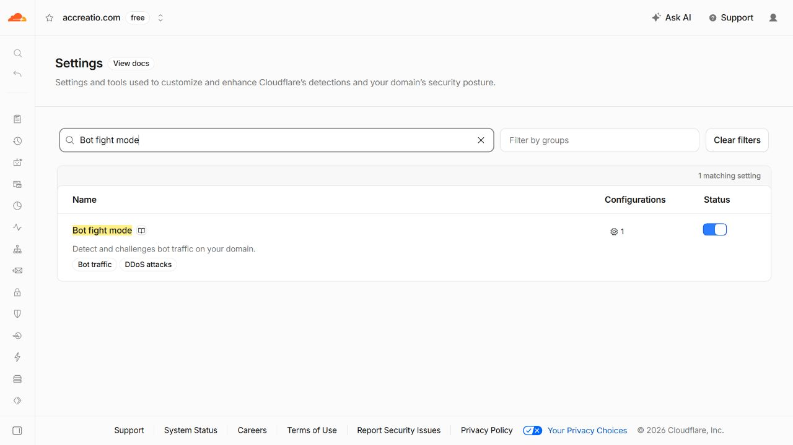](images/edge-bot-fight-mode.png)

Configuración reabierta y leída después de guardar.

[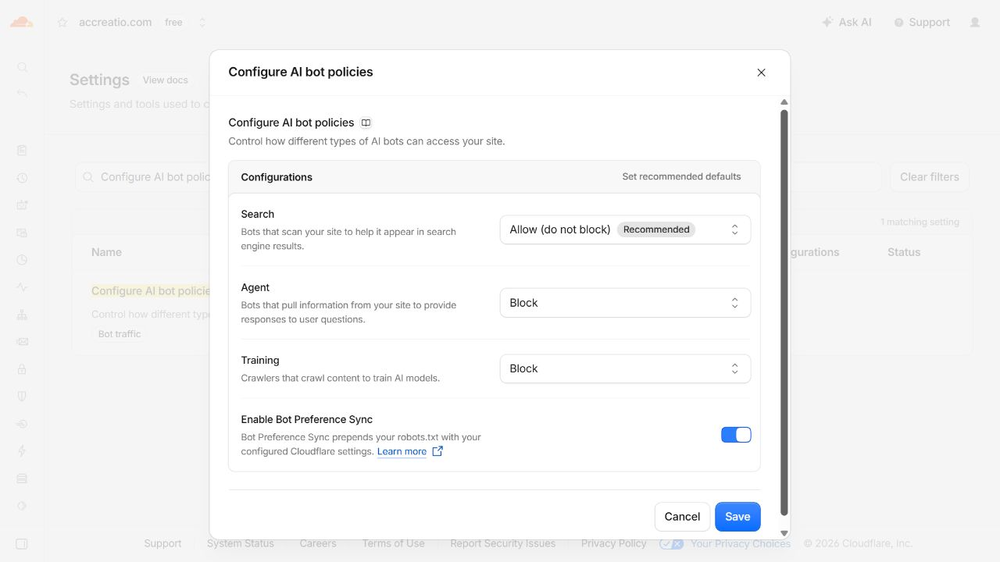](images/edge-ai-bot-policies.png)

Search continúa permitido; no hay credenciales en la captura.

[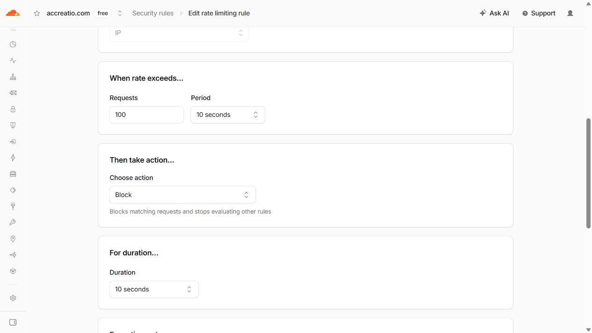](images/edge-rate-parameters.png)

Regla guardada, bloqueo temporal de 10 segundos.

[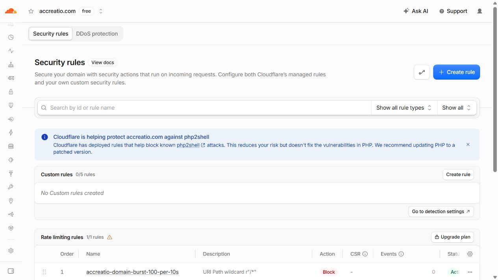](images/edge-rate-active.png)

Lista de reglas después del despliegue.

[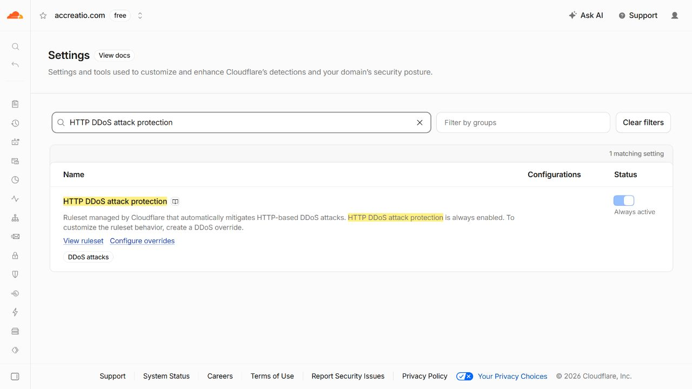](images/edge-ddos-active.png)

Protección siempre activa, preservada.

[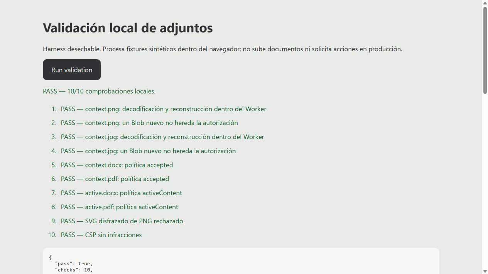](images/attachment-validation-iab.png)

Harness local desechable, fixtures sintéticos, sin subidas ni acciones en producción.

[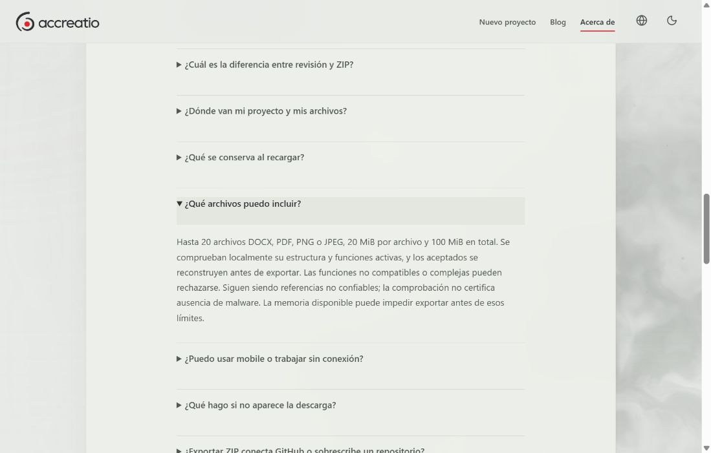](images/production-faq-attachment-policy.png)

Navegador integrado tras actualizar/reabrir: DOCX, PDF y PNG/JPEG; reconstrucción local, funciones no compatibles rechazadas y límite de la comprobación declarados.

- [Procedencia y recibos](updates/2026-10-22/provenance.json)
- [Resumen estructurado](updates/2026-10-22/delivery-summary.json)
- [Recibo de edge](updates/2026-10-22/edge-change-receipt.json)
- [Proveniencia del respaldo visual](updates/2026-10-22/design-backup-provenance.json)
- [Readback del pulido de diseño](updates/2026-10-22/design-hosted-readback.json)
- [Artefactos históricos del 20 de octubre](index.html)
- [Entrega histórica del 21 de octubre](final-release-2026-10-21.html)
- [Política de adjuntos, resumen estructurado](updates/2026-10-22/attachment-policy-summary.json)
- [Recibo final de producción](updates/2026-10-22/production-readback.json)
- [Verificación y límites del candidato entregado](updates/2026-10-22/candidate-verification-summary.json)
