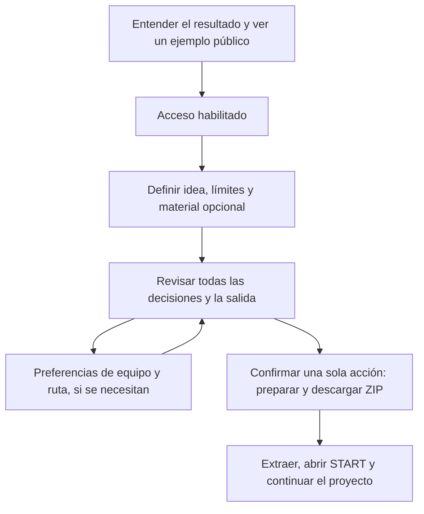

# Revisiones independientes previas

Lectura B: los siguientes informes incluyen juicios, hipótesis y propuestas. Léelos después de formar un diagnóstico preliminar si buscas reducir el anclaje. El master se conserva completo y sin cambios de texto. En copias de informes solo se reubicaron enlaces de evidencia local para hacerlos públicos; provenance.json registra hashes de originales y copias.

## Nota factual posterior a los dictámenes

La lectura técnica adicional trazó los dos caminos de ejecución. Aunque comentarios y el informe de producto describen un manifiesto común completo, la exportación web usa buildExportManifest y el escritor Electron retenido genera directamente otro conjunto de archivos. Los generadores de algunos contenidos sí se comparten. Se conservan los dictámenes anteriores como opiniones fechadas, acompañados de esta precisión de fuente. No se ejecutó Electron para comprobar su resultado. Véase technical-context.md y los extractos publicados.

## 01-producto.md

[Informe individual](independent-review-2026-10-20/01-producto.md)

### Evaluación independiente de producto — accreatio

Fecha: 20 de octubre de 2026, America/New_York. Evidencias del navegador fechadas en UTC el 21 de octubre. Código examinado: `70612512e2115036fa71a08075a596a04bbff942`, versión declarada 0.8.0.

#### Juicio

**accreatio entrega un preparador de paquetes de contexto que funciona, pero su propuesta todavía es más amplia y amable que el trabajo que realmente facilita.** Hay valor en convertir decisiones dispersas en archivos portables, revisables y listos para llevar a un IDE. El recorrido local examinado produjo un ZIP real. No encontré una transformación comparable de la idea en un proyecto de software específico: el prompt repite las respuestas y el plan describe la exportación. La continuación añade, además, la construcción de un orquestador que el usuario no pidió en el flujo básico.

Mi recomendación es concentrarlo primero en **preparar un buen encargo para trabajar con un asistente de programación**, con una salida autocontenida y una primera acción inequívoca. Aumentar integraciones o automatización antes de resolver esto ampliaría la superficie del producto sin probar que ahorra trabajo al usuario.

Este juicio evalúa utilidad, comprensión y esfuerzo de uso. No califica adhesión a AEKR ni la calidad de ese método. El contenido metodológico incluido en el ZIP se considera únicamente como parte de lo que recibe y debe entender una persona que llega al producto.

#### Método y límites

- Revisión desde cero de las superficies actuales, sin consultar memoria, auditorías previas, planes de diseño ni informes de otros revisores.
- Navegación real en Microsoft Edge, con sesiones nuevas y separadas: web pública `https://accreatio.com/` y frontend local `http://localhost:5173/`.
- En producción examiné bienvenida, explicación de privacidad, pantalla de acceso, About, FAQ de acceso y Blog. **No inicié sesión, no solicité códigos, no envié correo y no ejecuté mutaciones externas.**
- En local completé las ocho preguntas del recorrido de idea inicial y descargué el ZIP. Las API de cuenta se interceptaron únicamente en localhost con respuestas ficticias; el fixture usado está en la evidencia. Esto comprueba el recorrido del frontend y su exportación local; **no comprueba identidad, cuota, backend de cuenta ni exportación autenticada de producción**.
- Caso ficticio: una app para que veinte vecinos reserven turnos de riego y consulten tareas de un huerto; restricción de servicios gratuitos, Windows y datos personales mínimos. Se mantuvieron un generalista, ruta local y opciones iniciales de integración. No se activó orquestación; el ZIP no contiene su YAML.
- Inspeccioné nombres y tamaños de todas las entradas y leí START, PROJECT_PROMPT, discovery y SETUP del ZIP. No ejecuté sus instrucciones ni pedí a otra AI que construyera nada.
- Fuentes principales: `src/App.tsx`, `src/core.ts`, `src/webExport.ts`, componentes de bienvenida, About, creación, revisión y resultado; `shared/domain.ts`, `shared/exportManifest.ts` y los párrafos del Blog ya visibles públicamente. No examiné la aplicación Electron en ejecución.
- No hay entrevistas, métricas de adopción, prueba de retención ni comparación de resultados en proyectos reales. Las afirmaciones sobre público y abandono son hipótesis de producto, no datos de usuarios.

#### Lo que sí entrega y conviene conservar

1. **Un resultado que la persona se puede llevar.** El ZIP se descargó y pudo inspeccionarse sin instalación ni conexión a un proveedor de AI dentro del flujo de preparación local. Tiene 17 entradas: 59.261 bytes de contenido sin comprimir; el archivo ZIP ocupa 62.231 bytes. La construcción usa un manifiesto compartido y añade SETUP para los pasos que el navegador no puede hacer. Evidencia: `src/webExport.ts:100-148`; `product/zip-inspection.txt`; `product/local-output.png`.
2. **La interfaz reduce el formulario a preguntas manejables.** El nombre, el punto de partida, la idea y los límites tienen ayuda breve; los límites son opcionales; hay vuelta atrás y revisión. El caso ensayado conservó sus respuestas hasta el resultado. Esto es una mejora concreta frente a entregar una plantilla vacía sin explicación. Evidencia: `src/components/creation/GuidedCreation.tsx:227-266`; `product/local-review.md`.
3. **El equipo por defecto no exige diseñar una organización.** Un generalista basta y la configuración adicional queda plegada. La advertencia de que los roles preparan instrucciones y no ejecutan agentes es clara y honesta. Evidencia: `src/components/creation/GuidedCreation.tsx:486-550`; snapshot `.playwright-cli/page-2026-10-21T02-14-04-975Z.yml`.
4. **El producto permite inspeccionar antes de exportar.** El prompt se puede leer, copiar o descargar. El manifiesto y el plan están disponibles por separado. El resultado distingue preparación del ZIP de comprobación de que el navegador lo guardó. Evidencia: `src/components/creation/ReviewStage.tsx:212-284`; `src/components/creation/OutcomePanel.tsx:130-138`; `product/local-review-expanded.md`.
5. **Hay identidad visual y una navegación pública sencilla.** La bienvenida, el acceso y el resultado comparten una presentación reconocible; el producto no parece un conjunto de formularios sin conexión. Es una apreciación visual del recorrido observado, no un estudio de usabilidad. Evidencia: `product/public-home.png`, `product/public-access.png`, `product/local-output.png`.

#### Hallazgos principales

##### P0 — La salida no es autocontenida para su propio prompt

**Verificado.** PROJECT_PROMPT termina indicando que se sigan `toolkit/MASTER_SOP.md` y `toolkit/project-scaffolds/project-lifecycle/SOP.md`. Ninguna ruta existe en el ZIP descargado. Tampoco se proporcionan ahí instrucciones para obtenerlas. No es sólo una preocupación sobre un estándar: la persona entrega a su asistente una orden que depende de archivos ausentes.

Evidencia: `shared/domain.ts:533-545`; lista completa en `shared/exportManifest.ts:255-310`; comprobación de rutas ausentes y texto exportado en `product/zip-inspection.txt`.

**Impacto inferido.** La primera sesión en un IDE puede detenerse, buscar material fuera del paquete o inventar cómo continuar. El producto pierde parte de su ventaja de portabilidad justo cuando deja de estar presente para orientar al usuario.

**Propuesta.** Entregar un prompt que funcione sólo con lo incluido y comprobar sus referencias en cada exportación. Si se decide mantener una dependencia externa, nombrarla como requisito previo y proporcionar una resolución explícita. El éxito se mide abriendo el ZIP en una carpeta nueva y pudiendo cumplir la primera instrucción sin contexto de su autor.

##### P1 — El primer trabajo recomendado es construir infraestructura de coordinación

**Verificado.** START manda construir el orquestador antes de comenzar. La instrucción no depende de haber activado orquestación. El manifiesto incluye `orchestrator/BUILD_ORCHESTRATOR.md` siempre; el YAML sí es condicional. En el caso básico examinado recibí esa guía aunque no habilité orquestación.

Evidencia: `shared/exportManifest.ts:49-80`, `:88-109`, `:283-299`; START y ausencia del YAML en `product/zip-inspection.txt`.

**Impacto inferido.** Quien quería organizar una app de turnos termina pidiendo a una AI que construya herramientas de trabajo. Para un usuario experto puede ser una elección válida; para el recorrido básico aumenta dependencias y aplaza el primer avance en su idea. La frase de START que atribuye el resto del trabajo a la AI también transmite más facilidad de la demostrada por esta revisión.

**Propuesta.** El primer paso por defecto debería tratar el proyecto del usuario: revisar el encargo, identificar desconocidos y proponer un primer entregable pequeño. La preparación de un orquestador debe aparecer al elegir expresamente ese tipo de kit. Esto no exige eliminar esa capacidad del producto.

##### P1 — “Plan determinista” describe exportar archivos, no resolver la idea

**Verificado.** Para el huerto, el plan visible consta de crear la carpeta y preparar reglas/firma. PROJECT_PROMPT conserva la descripción y las restricciones prácticamente como fueron escritas. No añade historias de uso, alcance mínimo, prioridades ni un criterio específico de éxito. La ruta elegida se inserta como un valor en el prompt; el plan de exportación no deriva tareas del problema.

Evidencia: `src/core.ts:132-223`; `shared/domain.ts:533-553`; `product/local-review-expanded.md`, especialmente el plan y el prompt.

**Interpretación.** Una transformación determinista y local no tiene que inventar decisiones ni usar AI para ser útil. El problema es que el lenguaje amplio de “organizar la idea en un plan” deja ambiguo qué clase de plan recibe la persona.

**Propuesta.** Nombrar la vista actual “Qué incluirá tu paquete” o “Pasos de exportación”. Para aportar más valor sin llamadas a AI, recoger explícitamente problema, destinatario, primera versión, exclusiones y cómo reconocer un buen resultado. Exportar esas respuestas como un encargo legible, conservando como desconocido lo que el usuario no sabe. No hacen falta cinco nuevas pantallas: puede ser una sola sección con campos opcionales y un ejemplo.

##### P1 — El acceso exige compromiso antes de mostrar una prueba concreta de utilidad

**Verificado.** La visita nueva pasa por dos pantallas de bienvenida y luego requiere cuenta antes de nombrar o probar un proyecto. La pantalla pública observada ofrecía Google para cuentas nuevas y anunciaba cinco exportaciones por 24 horas. En las superficies públicas examinadas no encontré un ejemplo ya resuelto de prompt/ZIP ni una demo del armador sin cuenta.

Evidencia: `product/public-home.png`, `product/public-locality.md`, `product/public-access.png`; `src/components/account/WebAccountBoundary.tsx:770-793`; `src/components/WebProjectInformation.tsx:17-20`.

**Impacto inferido.** Se pide revelar identidad y entender condiciones antes de que el visitante pueda comparar el beneficio con rellenar una plantilla. No observé abandonos ni puedo cuantificar su efecto. La cuenta puede estar justificada para controlar una beta; la revisión no conoce una necesidad comercial que obligue a bloquear también una demostración local.

**Propuesta.** Como mínimo, mostrar un ejemplo completo y un ZIP de muestra público antes del acceso. Si el objetivo es autoservicio general, permitir probar un borrador local antes de exigir cuenta es una opción a evaluar. Si el objetivo sigue siendo beta restringida, declararlo en la primera pantalla y explicar qué consigue quien entra. No propongo eludir controles existentes.

##### P1 — El resultado explica la operación mejor que la siguiente acción

**Verificado.** La pantalla posterior muestra una lista extensa de archivos y estados. Su orientación principal es revisar Descargas y abrir el ZIP; la acción destacada es preparar otro ZIP. No explica en esa pantalla qué archivo leer primero ni ofrece el siguiente encargo de trabajo. Esa orientación está dentro del propio ZIP, y actualmente conduce al orquestador.

Evidencia: `src/components/creation/OutcomePanel.tsx:130-138`, `:164-215`; `product/local-output.png` y `product/local-output.md`.

**Propuesta.** Poner primero tres acciones breves: localizar el ZIP, extraerlo y abrir el punto de entrada correcto en el IDE. Mostrar ahí la instrucción que se copiará. Dejar la lista de evidencias disponible bajo un desplegable. La precisión operacional es útil; no debe ocupar el lugar de la orientación para usar el resultado.

##### P2 — Hay decisiones y explicaciones que añaden pantallas sin cambiar el resultado básico

**Verificado.** La ruta de idea inicial tiene ocho pasos. “Entrega” pide decidir cómo llevarse el proyecto, pero en la web la salida es un ZIP fijo. Equipo permite aceptar el generalista sin tocar nada. Revisión y confirmación vuelven a presentar opciones de revisión/descarga. La ruta de discovery añade un paso de adjuntos.

Evidencia: `src/components/creation/guidedFlow.ts:4-23`; `src/components/creation/DeliveryStage.tsx:45-74`; `src/components/creation/ReviewStage.tsx:285-321`; `src/App.tsx:1541-1569`; `product/local-delivery.png`, `product/local-confirm.md`.

**Propuesta.** Probar un recorrido básico de tres bloques: idea y límites, revisión del encargo, descarga. Fase, equipo, ruta e integraciones pueden ser personalización opcional. Mantener una confirmación clara para acciones que la requieran, sin convertir la validación de un ZIP local en una simulación de una operación de alto impacto. La revisión previa puede permanecer como vista, sin necesitar su propio resultado final.

##### P2 — El relato público contiene versiones incompatibles del producto

**Verificado.** En la sesión pública se pudo leer el Blog sin iniciar sesión; su segundo artículo dice que leer publicaciones requiere una sesión Access. La FAQ actual explica acceso por correo/código, mientras la pantalla pública de alta mostraba Google para cuentas nuevas. About y la bienvenida describen una edición de escritorio utilizable; la FAQ informa que está congelada. Estos textos pueden narrar momentos distintos, pero no separan con suficiente claridad historia y disponibilidad actual.

Evidencia: `product/public-blog.md`, párrafo del segundo artículo; `content/blog/founding-posts.json:27`; `product/public-faq-access.md` frente a `product/public-access.md`; `src/components/WebProjectInformation.tsx:13-20`; `src/components/AboutExperience.tsx:61-63`, `:90-94`.

**Impacto inferido.** El visitante tiene que reconciliar si el producto es privado o público, qué método debe usar y si hay una aplicación de escritorio disponible. La complejidad organizativa del producto pasa a ser trabajo del lector.

**Propuesta.** Tener una descripción corta y vigente del producto y sus métodos de acceso. Marcar los artículos históricos con fecha de vigencia o una corrección visible, conservando la procedencia. En la presentación inicial, describir sólo lo que se puede usar hoy y enlazar aparte la situación del escritorio.

#### Público y posicionamiento

Lo siguiente es una hipótesis basada en los requisitos y la salida, no en una base de clientes observada.

| Público posible | Ajuste de la versión examinada | Motivo |
| --- | --- | --- |
| Persona técnica que usa un IDE con AI y repite arranques de proyectos | Mayor | Puede valorar un paquete consistente de contexto, límites e instrucciones; ya sabe usar Markdown, repositorios y asistentes. |
| Autor de una idea sin experiencia técnica | Bajo a medio | Las preguntas son accesibles, pero la continuación exige IDE, AI y decisiones sobre infraestructura que no están resueltas por el producto. |
| Equipo que necesita compartir un encargo inicial | Medio | El ZIP facilita el traspaso, pero no se verificó colaboración, edición compartida ni actualización del encargo dentro de un repositorio existente. |
| Usuario que espera una aplicación funcionando | Bajo | La salida observada contiene preparación documental, no la app, su código ni un despliegue. La FAQ lo aclara, pero debería quedar claro antes del acceso. |

Propuesta de mensaje para probar: **“Prepara el encargo de tu próximo proyecto de software. Define para quién es, qué necesitas y qué límites debe respetar; llévate un paquete de Markdown para continuar en tu IDE con AI.”** Una segunda frase puede explicar que se prepara en el dispositivo. “Determinista” y “local-first” son propiedades útiles para un público técnico; no sustituyen la explicación del resultado.

#### Alternativas de alcance

| Alternativa | Qué ofrece | Qué simplifica | Evaluación |
| --- | --- | --- | --- |
| A. Preparador de encargos para trabajo con AI | Un encargo, un prompt autocontenido, fuentes y siguiente paso | Equipo y orquestación pasan a opcionales; menos documentos iniciales | **Recomendada para probar utilidad general.** Se acerca al valor ya existente y requiere poca infraestructura nueva. |
| B. Generador de un kit de trabajo metodológico específico | Convenciones, roles, documentos y preparación de orquestación | Reduce la ambigüedad de público, aunque conserve un paquete amplio | Coherente si ése es el objetivo real. La primera pantalla debe decir qué método/kit entrega y sus requisitos. No presentarlo como punto de partida universal. |
| C. Constructor de aplicaciones | Código, ejecución y despliegue del producto solicitado | Facilita el resultado final, pero multiplica dependencias y soporte | No lo recomiendo como siguiente ampliación. Es un producto de alcance mucho mayor que el examinado. |

El sustituto más directo de A es una plantilla Markdown rellenada a mano o una conversación directa con un asistente. accreatio debe demostrar que orienta mejor las decisiones, conserva mejor el encargo o hace más fácil trasladarlo. Que exporte más archivos no demuestra por sí mismo esa diferencia. Esta comparación es conceptual; no se hizo una investigación actual del mercado ni de precios.

#### Qué cambiar, quitar y agregar

**Cambiar primero:** hacer autocontenido el prompt; dirigir START hacia el proyecto elegido; llamar al plan por su función real; mostrar un ejemplo terminado antes del acceso; explicar la siguiente acción al descargar; actualizar mensajes públicos de disponibilidad.

**Quitar del recorrido básico:** la obligación implícita de construir un orquestador, la pantalla de entrega cuando no hay una elección real y la exposición principal de un manifiesto técnico largo. Reducir documentos iniciales para quien sólo pide un encargo; conservar un kit amplio como elección explícita, si tiene un público definido.

**Agregar:** un ejemplo pequeño completo, campos breves de primera versión/no incluido/criterio de éxito y un punto de entrada inequívoco. Evaluar posteriormente importar o actualizar un encargo existente sólo si los usuarios observados lo necesitan. No agregaría por ahora chat propio, AI alojada, gestión de equipos ni nuevas integraciones cloud.

#### Prioridades e impacto/esfuerzo

Estimaciones relativas de producto; no son una cotización de implementación.

| Orden | Cambio | Impacto esperado | Esfuerzo relativo | Cómo comprobar su utilidad |
| --- | --- | --- | --- | --- |
| 1 | Prompt autocontenido y primer paso que respete la opción de orquestación | Alto: elimina obstáculos concretos al usar la salida | Bajo a medio | Abrir el paquete en carpeta vacía; todas las referencias existen y la primera instrucción trata el proyecto elegido. |
| 2 | Público y resultado explícitos + ejemplo público | Alto: permite decidir si vale la pena entrar | Bajo | Una persona ajena describe correctamente qué recibirá y qué necesitará después, sin explicación del autor. |
| 3 | Resultado orientado a continuar y simplificación del recorrido básico | Medio a alto: reduce lectura y decisiones sin consecuencia | Medio | Observar si puede descargar, extraer y empezar sin ayuda; registrar dónde se detiene. |
| 4 | Encargo con primera versión, exclusiones y éxito declarado | Alto potencial, aún no validado: más valor que repetir el contexto | Medio | Comparar el paquete con una plantilla simple en un encargo real; identificar decisiones que dejó más claras. |
| 5 | Reconciliar FAQ, Blog y estado del escritorio | Medio: confianza y menos instrucciones contradictorias | Bajo | Una revisión cruzada de las pantallas vigentes describe el mismo acceso y la misma disponibilidad. |
| 6 | Nuevas integraciones, orquestación más potente o colaboración | Incierto antes de validar lo anterior | Alto | Posponer hasta observar una necesidad concreta que el núcleo simplificado no cubre. |

La siguiente validación valiosa sería observar a unas pocas personas del público elegido intentando continuar un proyecto propio, comparar contra una plantilla y preguntar qué parte conservaron al día siguiente. No hace falta seguimiento invasivo para empezar: observación consentida y notas bastan. No se debe inferir ahorro de tiempo ni disposición de pago del hecho de que el ZIP se descargue correctamente.

#### Evidencia reproducible

Base de evidencia: `.local/logs/independent-review-2026-10-20/product/`.

- Público: `public-home.png`, `public-locality.md`, `public-access.md/.png`, `public-about.md/.png`, `public-faq-access.md/.png`, `public-blog.md/.png`.
- Frontend local con cuenta ficticia: `install-local-fixture.js`, `local-home-v2.md`, `local-delivery.png`, `local-review.md`, `local-review-expanded.md/.png`, `local-confirm.md`, `local-confirm-export.md`, `local-output.md/.png`.
- Salida examinada: `.playwright-cli/huerto-comunitario.zip`; inventario, tamaños, hash y textos seleccionados en `zip-inspection.txt`. SHA-256: `1E24BF0320113C13139EAFF9063579A8DF3F7DA794641BB144B445DAC98F0590`.
- Los snapshots automáticos de cada paso están en `.playwright-cli/` bajo esa misma base. El primer intento de fixture falló por comillas de PowerShell; se corrigió mediante archivo y no alcanzó a instalar respuestas ni a navegar al producto local.

No se modificó código del producto ni se ejecutó el trabajo propuesto por el ZIP. Este informe es la evaluación de un revisor independiente dentro de esta sesión; no es validación de clientes, certificación de seguridad ni prueba de éxito comercial.

---

## 02-diseno-visual.md

[Informe individual](independent-review-2026-10-20/02-diseno-visual.md)

### Evaluación independiente de diseño visual — accreatio

Fecha de inspección: 20 de octubre de 2026, hora de Nueva York; las capturas llevan fecha UTC del 21 de octubre. Código local observado: `70612512e2115036fa71a08075a596a04bbff942`.

#### Dictamen

La base visual es coherente y está bastante más resuelta en el formulario de creación que en la entrada y la lectura del Blog. La paleta oscura, el acento lavanda, los títulos claros y la columna de trabajo contenida producen una interfaz reconocible. El creador evita el aspecto de un formulario administrativo genérico y mantiene una acción principal identificable.

No recomiendo rehacer la marca ni añadir más ornamentación. Recomiendo una pasada de legibilidad y consistencia: hacer distinguibles los campos sin foco, corregir la justificación del Blog, reducir la densidad de la entrada y resolver detalles de acabado. Hay fallos concretos y oportunidades editoriales; no todo lo que sigue es un defecto funcional.

La evaluación usa criterios de comunicación visual, legibilidad, interacción y acabado del producto. AEKR no se utilizó como marco de calidad, requisito estético ni argumento de aprobación.

#### Método y límites

- Navegador real Microsoft Edge mediante Playwright. Producción pública `https://accreatio.com/` observada sin iniciar sesión, aceptar términos, enviar formularios ni abrir proveedores externos.
- Viewports principales: **1440 × 1000 CSS px** y **390 × 844 CSS px**. En producción, la barra de desplazamiento deja 375 px de ancho útil en capturas móviles. No se probó un dispositivo físico, Safari, lector de pantalla, zoom del sistema ni todos los tamaños intermedios.
- Producción: bienvenida 1–2, entrada, Blog, About y preferencias de cookies. Local: los ocho pasos del creador, error de campo vacío, roles expandidos, revisión final, diálogo previo a ejecución y menú de cuenta.
- Los interiores se observaron en `http://localhost:5173/` con respuestas de cuenta **ficticias**, cuota 5 y un correo `.test`. El harness está en `.local/logs/independent-review-2026-10-20/design/inspect-local.mjs` y usa `../review-fixture.mjs`. Es evidencia del frontend; no prueba autenticación, cuota, backend, exportación real ni equivalencia completa con producción. No se ejecutó la revisión final ni se descargaron proyectos o datos de cuenta.
- Las capturas locales se hicieron con movimiento reducido. Producción conservó su presentación normal. No se juzgó la comodidad de la animación durante una sesión prolongada.
- Primero se observaron píxeles; después se consultaron componentes y CSS para localizar causas. No se leyeron memoria, documentación histórica, `docs/design*`, `docs/archive` ni informes de otros auditores. No se implementaron cambios en el producto.
- Una captura de página completa con scroll previo puede desplazar elementos fijos. Las capturas locales de referencia se regeneraron desde scroll 0 y los dos overlays se capturaron como viewport. Esos artefactos iniciales no se consideran fallos del producto.

#### Lo que conservaría

**La jerarquía del creador.** Pregunta principal, ayuda, control y siguiente acción están en un orden estable. El formulario deja suficiente aire entre decisiones y no obliga a leer una explicación extensa para encontrar el campo. Las opciones de los pasos 2 y 5 combinan borde, fondo y marca de selección; la selección no depende solo del color. Evidencia: `local-builder-desktop.png`, `local-step-2-desktop.png` y `local-step-5-desktop.png`.

**La adaptación móvil básica.** A 390 px, el creador mantiene una columna, botones utilizables, etiquetas visibles y texto sin recortes en los estados inspeccionados. El ancho de documento medido en la revisión local fue 390 px: no se encontró desbordamiento horizontal en esa muestra. La navegación móvil tiene objetivos de 44 px para New project, cuenta, Blog, About e idioma. Evidencia: `local-builder-mobile.png`, `local-roles-expanded-mobile.png`, `local-step-8-mobile.png` y `local-measurements.json`.

**La señalización del error de campo.** El estado vacío muestra texto coral junto al campo y un aviso adicional, con borde de error y foco lavanda. Es más claro que un aviso genérico separado. Evidencia: `local-builder-empty-error.png` y `local-builder-mobile.png`. Esto no constituye una auditoría completa de anuncios por lector de pantalla.

**La familia gráfica principal.** El símbolo orbital, la paleta azul violeta, los contenedores oscuros y los iconos de línea funcionan juntos. Los iconos de acciones suelen acompañar texto, evitando que la persona tenga que adivinar su significado. Mantendría esos activos y la marca existente.

**El diálogo de confirmación.** En el viewport móvil inspeccionado se distinguen el modo elegido, el efecto de la operación, la cancelación y la acción. Los objetivos son amplios y la superficie está claramente separada del fondo. Evidencia: `local-confirm-mobile.png`. Hay un detalle de presentación de ruta redundante que se recoge abajo.

#### Hallazgos comprobados

| ID | Hallazgo y efecto observable | Evidencia | Prioridad / impacto / esfuerzo |
| --- | --- | --- | --- |
| V01 | **El campo en estado neutro se separa muy poco de su entorno.** El borde medido es `#2b3246`, el relleno `#0d1019` y la tarjeta exterior muestreada `#0f111b`. La relación borde–relleno es **1,49:1** y borde–exterior aproximadamente **1,48:1**. El texto sí tiene contraste alto; el problema es reconocer la superficie editable antes de enfocar. | `local-builder-desktop.png`, `local-measurements.json`, `field-pixel-samples.json`, `contrast-measurements.json`; `src/styles.css:48`, `src/styles.css:51`, `src/styles.css:820`. | **P1** / alto para baja visión / bajo. Elevar el contraste de la delimitación de entradas y validar los controles equivalentes. |
| V02 | **La justificación produce huecos y ríos de blanco en el Blog móvil.** Con una columna medida de 313,96 px, cuerpo de 14 px e interlínea de 23,8 px, varias líneas estiran mucho los espacios entre palabras. La cadencia se vuelve irregular pese a tener una interlínea razonable. | `public-mobile-blog-reading.png`, `public-mobile-blog-top.png`, `public-mobile-measurements.txt`; `src/components/BlogExperience.css:280`–`286`. | **P2** / medio-alto para lectura / bajo. Alinear al inicio, especialmente en móvil; conservar ancho e interlínea y volver a ver los párrafos largos. |
| V03 | **La entrada concentra demasiado texto pequeño antes de su única acción.** A 390 × 844, el aviso de políticas usa **11,9 px**, ocupa aproximadamente 295 px y el botón de Google comienza a **906 px** desde el inicio de la página. El botón requiere scroll antes de poder empezar. Después aparecen más párrafos y enlaces legales repetidos. | `public-mobile-signin.png`, `public-desktop-signin.png`, `public-signin-measurements.txt`; `src/web-branding.css:537`–`550`, `src/web-branding.css:623`–`625`. | **P2** / medio-alto / medio. Reorganizar el texto y sus niveles visuales manteniendo visible el aviso necesario junto a la continuación. No ocultar condiciones para ganar espacio. |
| V04 | **El primer título de bienvenida recibe un contorno negro nativo.** Se ve un rectángulo oscuro alrededor del H1 sobre una tarjeta ya oscura, como un residuo del navegador. Está confirmado también en local: H1 activo, `outline: auto 1px rgb(16,16,16)`. | `public-desktop-initial.png`, `local-initial.png`, `local-measurements.json`; `src/components/Onboarding.tsx:30`, `src/components/Onboarding.tsx:49`, `src/styles.css:709`. La entrada ya tiene una excepción específica en `src/web-branding.css:528`. | **P3** / bajo / bajo. Dar al encabezado enfocado un tratamiento deliberado; conservar el foco semántico y los anillos de controles interactivos. |
| V05 | **El diálogo repite el nombre del ZIP como ruta y nombre.** Se presenta `independent-visual-review.zip: independent-visual-review.zip`. El bloque monoespaciado ocupa dos líneas y parece una ruta técnica sin añadir información en web. | `local-confirm-mobile.png`, `local-confirm-snapshot.txt`. | **P3** / bajo / bajo. Mostrar el nombre una sola vez y reservar estructura de rutas para cuando aporte una distinción real. |

Para V01, la referencia de accesibilidad es el contraste de **3:1** para información visual necesaria para identificar controles y estados, explicado en [WCAG 2.2, contraste no textual](https://www.w3.org/WAI/WCAG22/Understanding/non-text-contrast.html). La medición identifica un problema concreto de delimitación del campo, no certifica el conjunto de la aplicación. Se muestreó una tarjeta translúcida y un fondo específico; deberán comprobarse también otras posiciones y estados.

V03 es una medición de densidad y ubicación. Un cuerpo de 11,9 px o un botón bajo el primer pliegue no demuestran por sí solos incumplimiento WCAG ni abandono de usuarios. La inferencia de diseño es que la pantalla da más peso a la explicación institucional que a la decisión inmediata.

#### Preferencias de diseño y oportunidades

Estas propuestas son juicios profesionales o hipótesis para comprobar, no errores funcionales demostrados.

| Conservar / cambiar / quitar / agregar | Propuesta y motivo | Impacto / esfuerzo |
| --- | --- | --- |
| **Cambiar** la composición de entrada | La tarjeta inicial queda a la izquierda y gran parte del desktop se dedica a atmósfera. Es intencional y puede funcionar como identidad, pero se explica un resultado todavía invisible. Reequilibraría la composición con una muestra real y pequeña del resultado: prompt, plan y árbol de archivos. No agrandaría más el título ni el logo. Evidencia: `public-desktop-initial.png`. | Medio / medio. Hipótesis de comprensión; no se midió conversión. |
| **Agregar** una muestra antes del acceso | Un ejemplo de salida o una vista de tres artefactos haría tangible el producto sin crear un carrusel decorativo. Serviría mejor que otro párrafo sobre el método. Debe ser ejemplo identificado, no falsa ejecución o contenido de otra persona. | Medio-alto / medio. |
| **Cambiar** el Blog como destino de lectura | Tres artículos completos seguidos producen una página de **7290 px** en la muestra móvil. Añadir un índice breve por título o entradas independientes permitiría elegir lectura y volver a orientarse. No hacen falta imágenes de relleno. Evidencia: `public-mobile-blog.png`, `public-mobile-measurements.txt`; render de artículos completos en `src/components/BlogExperience.tsx:488`–`524`. | Medio / medio. |
| **Cambiar** la escala de texto auxiliar | FAQ, ToS y Cookie preferences llegan a **10,5 px** en el creador móvil; la navegación principal usa 12,25 px. Sus áreas táctiles suelen ser de 44 px, así que el problema observado es de lectura, no de tamaño del área pulsable. Subiría un nivel la ayuda útil y conservaría las etiquetas secundarias realmente secundarias. Evidencia: `local-measurements.json`; `src/web-branding.css:213`–`237`. | Medio / bajo. No se declara un incumplimiento solo por tamaño. |
| **Cambiar** el peso del CTA final | El botón final pasa de rectángulo moderado a gran píldora, brillo y cohete. Es visible, pero introduce otra voz gráfica y hace parecer más extraordinaria una revisión seca. Mantendría énfasis y tamaño accesible con la familia de botones ya establecida. Evidencia: `local-step-7-desktop.png` frente a `local-step-8-desktop.png`. | Bajo-medio / bajo. Preferencia de consistencia. |
| **Quitar** los perfiles sociales pendientes de la superficie pública hasta que tengan destino | X y LinkedIn tienen aspecto de iconos sociales vecinos al enlace de Instagram, pero el árbol accesible los identifica como imágenes de perfil pendiente. No están rotos como enlaces: no son enlaces. Aun así, visualmente prometen una acción que no existe. Evidencia: `public-mobile-signin.png`, snapshots públicos; `src/components/AekrSignature.tsx:42`, `src/components/AekrSignature.tsx:63`. La recomendación no implica redibujar activos ni alterar su propiedad. | Bajo / bajo. |
| **Cambiar** la separación visual de acciones de cuenta | Exportar datos, salir y eliminar cuenta reciben casi el mismo botón. Separaría la acción irreversible mediante agrupación y texto, conservando claridad y sin depender solo del rojo. No se abrió la eliminación ni se evaluó su confirmación. Evidencia: `local-account-menu-mobile.png`. | Medio / bajo. Riesgo de confusión hipotético, no eliminación accidental observada. |
| **Conservar** el fondo y moderar su protagonismo | La atmósfera da personalidad. En el creador es secundaria y funciona mejor que en la bienvenida. Mantendría esa relación: la decisión y el resultado deben llevar el contraste y la atención principales. No recomiendo sustituirla por otra ilustración generada. | Medio / bajo-medio. |

#### Orden de trabajo recomendado

1. Corregir delimitación de campos y verificar contraste en estados neutro, hover, foco y error. Mantener los buenos indicadores ya presentes.
2. Corregir alineación del Blog y reorganizar entrada y tamaños auxiliares. Verificar en los mismos viewports antes de añadir secciones.
3. Resolver contorno del H1, nombre duplicado del ZIP, iconos pendientes y consistencia de botones.
4. Probar una muestra real de salida y navegación editorial. Evaluar si mejora la comprensión con personas ajenas al proyecto; no asumirlo a partir de esta revisión.

No abriría una nueva dirección artística para resolver estos puntos. El trabajo con mayor retorno está en la presentación de la información y la calidad de los estados existentes.

#### Evidencia visual consultada

Directorio de evidencia: [.local/logs/independent-review-2026-10-20/design](gallery.json).

Se abrieron y observaron los píxeles de estas capturas, no solo sus nombres o snapshots:

- Públicas: `public-desktop-initial.png`, `public-desktop-welcome-2.png`, `public-desktop-signin.png`, `public-desktop-blog.png`; `public-mobile-signin.png`, `public-mobile-blog.png`, `public-mobile-blog-top.png`, `public-mobile-blog-reading.png`, `public-mobile-about-top.png`, `public-mobile-cookie.png`.
- Locales con fixture: `local-initial.png`, `local-builder-desktop.png`, `local-builder-empty-error.png`, `local-builder-mobile.png`, `local-step-2-desktop.png`, `local-step-3-desktop.png`, `local-step-4-desktop.png`, `local-step-5-desktop.png`, `local-step-6-desktop.png`, `local-roles-expanded-desktop.png`, `local-roles-expanded-mobile.png`, `local-step-7-desktop.png`, `local-step-8-desktop.png`, `local-step-8-mobile.png`, `local-confirm-mobile.png`, `local-account-menu-mobile.png`.

`public-mobile-about.png` se capturó, pero no se utilizó como revisión de píxeles de la página completa. About se evaluó en su primer viewport y mediante estructura accesible; no se afirma revisión visual de cada bloque inferior. Tampoco se inspeccionó visualmente la aplicación Electron ni estados reales de éxito, error de red, cuota agotada o cuenta pendiente.

Los valores reproducibles están en `local-measurements.json`, `field-pixel-samples.json`, `contrast-measurements.json`, `public-mobile-measurements.txt` y `public-signin-measurements.txt`. Los snapshots describen estructura y texto; por sí solos no prueban legibilidad visual ni accesibilidad completa.

---

## 03-comunicacion.md

[Informe individual](independent-review-2026-10-20/03-comunicacion.md)

### Revisión independiente de comunicación y microcopy

Fecha: 20 de octubre de 2026, America/New_York. Auditoría exclusivamente editorial, sin implementación.

#### Dictamen

accreatio explica razonablemente bien **qué pasos seguir**, pero explica peor **por qué una persona concreta debería empezarlos**. Las preguntas del creador son más claras que la presentación del producto. El tono tranquilo y la precisión sobre revisión, archivos y control del usuario merecen conservarse. El problema principal no es la falta de texto: es la combinación de lenguaje técnico prematuro, información decisiva repartida entre varias superficies y algunas instrucciones incompatibles entre sí.

Las dos correcciones más urgentes son verificables: la FAQ integrada indica entrar por correo y código aunque el acceso público observado ofrece Google; un artículo público afirma que leer el Blog requiere una sesión de Access, aunque se leyó completo sin iniciar sesión. Esas discrepancias perjudican la confianza más que una frase comercial poco atractiva.

No recomiendo una voz más enfática ni más promesas. Recomiendo una promesa más concreta, una muestra del resultado y menos vocabulario interno en el recorrido principal.

#### Método, independencia y límites

- Se revisaron los textos actuales de `src/components/Onboarding.tsx`, `WebExperience.tsx`, `AboutExperience.tsx`, `AppFrame.tsx`, `src/components/account/`, `src/components/creation/` y las cadenas pertinentes de `src/App.tsx`. También los materiales directamente enlazados: `WebProjectInformation.tsx`, FAQ y documentos públicos, y los artículos servidos por el Blog.
- Se observó `https://accreatio.com/` con Edge en una sesión aislada: bienvenida, privacidad, acceso, About en ES/EN, respuestas de la FAQ y Blog. No se pulsó Google, no se introdujeron correos ni códigos y no se realizó ninguna mutación externa. La captura ocurrió aproximadamente entre 2026-10-21 02:10 y 02:18 UTC, todavía 20 de octubre en la zona del proyecto.
- Se recorrió `http://localhost:5173/` hasta la confirmación de exportación, con respuestas ficticias, sin adjuntos, sin ejecutar ni descargar. Las respuestas de cuenta se interceptaron **solo para localhost** con una cuenta sintética y cinco usos. Eso permite observar la interfaz interna; no valida login, backend, cupos reales, seguridad, exportación ni comportamiento desplegado.
- El checkout leído fue `70612512e2115036fa71a08075a596a04bbff942`. La página pública mostró versión 0.8.0. No se estableció paridad exacta entre el despliegue y ese commit.
- No se consultaron memoria, auditorías anteriores, documentos de diseño, archivos históricos ni informes de otros revisores. AGENTS.md se usó para seguridad operativa, sin usar criterios AEKR para juzgar el producto.
- **Verificado** significa texto leído en fuente o interfaz, identificado en cada caso. **Inferido** significa una consecuencia editorial plausible. **Recomendado** es una propuesta, no una conclusión obtenida de pruebas con usuarios.
- No se midieron conversión, abandono, comprensión ni el tiempo anunciado de 5–10 minutos. No se verificaron criptografía, ausencia de telemetría, almacenamiento remoto ni las afirmaciones técnicas como garantías de seguridad.
- La revisión de avisos evalúa claridad, consistencia y ubicación. No determina validez contractual, bases jurídicas, suficiencia del consentimiento ni cumplimiento normativo.

Las evidencias temporales propias están únicamente en `.local/logs/independent-review-2026-10-20/copy/`. Los snapshots distinguen `public-*` de `local-fixture-*`. `local-initial.md` corresponde a un intento fallido de instalar el fixture y conserva todavía la página pública; no se utiliza como evidencia local.

#### Qué conservar

1. **Las preguntas conversacionales del creador.** “¿Cómo se llama tu proyecto?”, “¿Qué quieres crear?” y “Unas frases bastan” reducen el esfuerzo de responder sin fingir que ya se conocen todos los requisitos. Evidencia: `src/components/creation/GuidedCreation.tsx:227–253` y `:308–328`; observado en `local-fixture-name.md` y `local-fixture-idea.md`.
2. **La opcionalidad explícita.** “Omitir por ahora” y ejemplos concretos para los límites son mejores que un campo vacío con una etiqueta abstracta. Evidencia: `src/components/creation/GuidedCreation.tsx:166–182`, `:248–250` y `src/components/creation/GuidedAttachments.tsx:37–45`.
3. **La distinción entre roles y agentes en ejecución.** “Definir roles prepara instrucciones; no contrata ni ejecuta agentes” evita una promesa falsa. Evidencia: `src/components/creation/GuidedCreation.tsx:516–519`; observado en `local-fixture-team-es.md`.
4. **La revisión previa y el nombre de la acción final.** La confirmación diferencia “Revisar sin descargar” de “Crear y descargar ZIP”. La acción sigue dependiendo de una confirmación explícita. Evidencia: `src/App.tsx:1534–1568` y `:1727–1749`; observado en `local-fixture-confirm-es.md`.
5. **La precisión sobre la descarga.** “ZIP preparado; descarga solicitada” y la indicación de revisar Descargas son más honestas que afirmar que el archivo ya está guardado. Evidencia de fuente: `src/components/creation/OutcomePanel.tsx:79–82` y `:133–137`; no se ejecutó ese resultado durante esta auditoría.
6. **Los errores que explican qué hacer y qué se conserva.** Los mensajes sobre ventana bloqueada, borrador sin guardar, código vencido y reintento tienen una acción reconocible. Evidencia de fuente: `src/components/account/WebAccountBoundary.tsx:57–103`, `:937–944` y `:1002–1006`.
7. **La separación explícita entre cuenta y proyecto.** Es una diferencia útil del producto, siempre que se explique con palabras de usuario y sin convertir “local” en una garantía sobre todo el servicio. Evidencia: `src/components/Onboarding.tsx:79–90`, `src/components/account/AccountPolicyFields.tsx:17–29`.
8. **La independencia de las preferencias de cookies.** “Iniciar sesión no acepta cookies opcionales” es breve y entendible. Evidencia: `src/components/account/CookiePreferences.tsx:60–86`.

#### Hallazgos priorizados

Las prioridades son editoriales: P1 = instrucción o afirmación pública contradictoria; P2 = comprensión y confianza; P3 = acabado. Impacto y esfuerzo son estimaciones relativas, no métricas de negocio.

| ID | Prioridad | Acción | Impacto probable | Esfuerzo |
|---|---|---|---|---|
| C01 | P1 | Actualizar la FAQ integrada de acceso | Evita buscar un método inexistente | Bajo |
| C02 | P1 | Señalar el contexto histórico del artículo del Blog | Evita una contradicción pública sobre acceso y privacidad | Bajo para aviso; medio para revisión editorial |
| C03 | P2 | Corregir qué datos de adjuntos conserva el borrador | Aclara privacidad y recuperación | Bajo |
| C04 | P2 | Corregir la instrucción ES posterior al dry run | Evita volver a la pantalla equivocada | Bajo |
| C05 | P2 | Explicar resultado, audiencia y siguiente uso al comienzo | Facilita decidir si el producto sirve | Medio |
| C06 | P2 | Separar explicación de seguridad web y escritorio | Mejora comprensión y credibilidad | Bajo/medio |
| C07 | P2 | Ordenar el acceso y aclarar operador/estado documental | Reduce lectura repetida antes del CTA | Medio |
| C08 | P2 | Unificar vocabulario y traducción | Reduce aprendizaje innecesario | Bajo/medio |
| C09 | P2 | Mostrar condiciones y disponibilidad en contexto | Evita expectativas de acceso o escritorio incorrectas | Bajo |
| C10 | P3 | Precisar el significado del tiempo estimado | Evita confundir completar preguntas con terminar el proyecto | Bajo |

##### C01 — La FAQ prescribe un método distinto al disponible

**Verificado:** la FAQ integrada dice “introduce tu correo y el código de un solo uso” y desarrolla el transporte controlado de correo. Fuente ES/EN: `src/components/WebProjectInformation.tsx:17–20`. En producción se observó “Continuar con Google”, sin formulario de correo/código: `copy/public-es-signin.md:38–41`. La FAQ pública separada ya usa “choose an available sign-in method”: `public/legal/faq.html:47–63`. El aviso completo de términos indica que OTP propio está deshabilitado en producción: `public/legal/terms.html:35–42`.

**Inferido:** una persona que usa la ayuda para resolver el acceso puede buscar una opción que esa misma interfaz no ofrece. La longitud de la respuesta dificulta descubrir que se trata de información condicionada.

**Recomendado:** una respuesta corta que sirva para los métodos efectivamente habilitados; separar cuenta, cuota y recuperación en preguntas distintas. No prometer acceso universal ni activación de un método futuro.

Antes: “Después del resumen de privacidad, introduce tu correo y el código de un solo uso…”

Propuesta ES: “Sí. Para abrir el creador necesitas iniciar sesión con uno de los métodos que aparecen en la pantalla de acceso. Las cuentas nuevas admitidas actualmente usan Gmail o Google Workspace. La beta puede limitar el acceso.”

Propuesta EN: “Yes. Sign in using one of the methods shown on the sign-in screen to open the project builder. New accounts currently require Gmail or Google Workspace. Access to the beta may be limited.”

La frase concreta sobre nuevas cuentas debe mantenerse sincronizada con la configuración real. Quitar de esta respuesta “Un cliente modificado puede generar archivos localmente”: es una precisión de arquitectura que no resuelve la duda del visitante (`src/components/WebProjectInformation.tsx:19–20`). Puede conservarse en documentación técnica.

##### C02 — El Blog público cuenta una arquitectura anterior como si fuera la actual

**Verificado en producción:** el segundo artículo, “Nebula made ideas for accreatio”, afirma “Reading published posts still requires a valid Access session”. Se leyó ese artículo completo sin iniciar sesión. Snapshot: `copy/public-blog.md:38–54`, en especial `:50`. El mismo texto existe en `content/blog/founding-posts.json:27`; esa coincidencia no demuestra paridad general de la base editorial y el seed. About afirma que la lectura del Blog es pública (`src/components/WebProjectInformation.tsx:128–130`).

El artículo tiene fecha de agosto. Que sea histórico es legítimo; lo que falta es señalar de forma visible que sus detalles ya no describen la operación actual. La cadena de tecnicismos JWT/RS256/JWKS y la frase “D1 stores… only post rows” amplían el riesgo de que alguien use una explicación editorial antigua como declaración actual de privacidad.

**Inferido:** una corrección pasada presentada con mucha seguridad técnica termina debilitando la confianza si ahora contiene otra afirmación desactualizada.

**Recomendado:** preservar autoría, fecha y procedencia; añadir una nota editorial visible antes del artículo, enlazada a la descripción actual. No reescribir silenciosamente la historia ni afirmar una arquitectura nueva sin verificarla.

Propuesta EN: “Historical architecture note. This article describes the August 2026 release. Blog reading is now public; some access and account details below have changed. See the current product information and privacy notice.”

Propuesta ES: “Nota histórica de arquitectura. Este artículo describe la versión de agosto de 2026. La lectura del Blog ahora es pública y algunos detalles de acceso y cuentas han cambiado. Consulta la información actual del producto y el aviso de privacidad.”

##### C03 — El texto de adjuntos dice que se guardan nombres, pero la serialización no los guarda

**Verificado en fuente:** `src/components/creation/GuidedAttachments.tsx:63–65` dice que el borrador guarda “nombres y cantidades”. También aparece en `src/components/creation/FoundationStage.tsx:179–182`. La serialización actual vacía `attachments` y guarda únicamente un marcador con el número: `src/draftStore.ts:72–83`. La FAQ pública es más exacta: los nombres y bytes seleccionados no se conservan (`public/legal/faq.html:107–114`).

**Inferido:** “nombres” podría interpretarse como nombres del proyecto, pero dentro de la nota de archivos seleccionados su lectura natural son los nombres de los adjuntos. Es una ambigüedad evitable en una promesa de privacidad.

Propuesta ES: “Guardamos tus respuestas y la cantidad de adjuntos en este navegador. Los archivos y sus nombres no se guardan en el borrador. Tendrás que seleccionarlos de nuevo después de recargar.”

Propuesta EN: “This browser saves your answers and the number of attachments. The draft does not save the selected files or their names. Select them again after a reload.”

No se ejecutó una prueba de persistencia de archivos; el hallazgo compara texto con la función explícita de serialización.

##### C04 — La recuperación ES del dry run apunta a Entrega; EN apunta a Review

**Verificado en fuente:** `src/components/creation/OutcomePanel.tsx:145–147` indica en español “Desactívalo en Entrega”, mientras en inglés dice “Turn it off in Review”. La casilla vive en Revisión (`src/components/creation/ReviewStage.tsx:262–290`), y también hay elección dentro de Confirmar exportación (`src/App.tsx:1541–1568`). El resultado afectado se refiere al recorrido sin el botón web de descarga posterior; no se reprodujo en un ejecutable de escritorio.

Propuesta ES: “La revisión terminó sin crear archivos. Vuelve a Revisión, desactiva «Revisar sin escribir nada» y confirma para crear.”

Propuesta EN: “The review finished without creating files. Return to Review, turn off ‘Review without writing’, and confirm to create.”

Conservar la precisión “sin crear archivos”; no convertir la revisión en una afirmación de que el proyecto fue implementado o validado funcionalmente.

##### C05 — Se describe una transformación, pero no se concreta pronto su utilidad ni su destinatario

**Verificado:** la primera pantalla dice “Lo que vas a crear” y enumera “prompt explícito”, “plan determinista” y “archivos de proyecto”. El resultado se define como un contenedor: carpeta o ZIP. Evidencia: `src/components/Onboarding.tsx:49–67`, `copy/public-return.md:21–32`. About usa “Un punto de partida local-first… preparado para continuar” (`src/components/AboutExperience.tsx:112–121`). La frase más esclarecedora —qué incluye y que no construye una aplicación terminada— aparece dentro de una FAQ cerrada (`src/components/WebProjectInformation.tsx:5–8`). La frase de marca no ayuda en la web: `.formation-mark small` está oculta (`src/web-branding.css:43–44`).

**Inferido:** el producto parece dirigido a quien prepara un proyecto de software para trabajarlo después con personas o asistentes IA: hay prompts, roles, Git, GitHub e IDE. Esa audiencia no se declara; el ejemplo de nombre “Mi huerto urbano” incluso puede leerse como planificación de cualquier actividad (`src/components/creation/GuidedCreation.tsx:308–309`). No es evidencia de que deba excluirse otro público.

**Recomendado:** elegir y declarar una audiencia primaria; presentar primero el trabajo que ahorra, luego el contenido del ZIP. Mostrar un ejemplo estático del resultado antes de pedir cuenta. No hace falta más retórica.

Propuesta de encabezado ES: “Dale una estructura clara a tu idea de software.”

Propuesta de explicación ES: “Responde unas preguntas y descarga un ZIP con la definición de tu proyecto, un prompt para continuar, un plan paso a paso y tus archivos de apoyo. Tú decides cómo construirlo después.”

EN: “Give your software idea a clear starting point.” / “Answer a few questions to download a ZIP with your project brief, a prompt for the next step, a step-by-step plan, and your supporting files. You choose how to build it next.”

“Software” es una propuesta de posicionamiento que requiere decisión del propietario, no un hecho impuesto por esta auditoría. Si el público buscado es más amplio, mostrar ejemplos de ese público y un resultado que pruebe su utilidad. Mantener cerca una frase breve: “Prepara el inicio; no genera una aplicación terminada.”

Agregar un enlace secundario “Ver un ejemplo / View an example” con tres vistas: definición breve, fragmento del plan y lista realista de archivos. Eso ofrece una prueba comprensible sin testimonios ni cifras inventadas.

##### C06 — La explicación de seguridad pública habla al desarrollador y mezcla superficies

**Verificado:** About web muestra “Renderer aislado, IPC limitado… sin interpolación de shell… firma local de auditoría”. Las mismas cadenas se pasan sin adaptación a la superficie (`src/App.tsx:157–158`, `:221–222`, `:2398–2402`). Se observaron en `copy/public-en-about.md:35–38` y `copy/public-es-about.md:35–38`. El texto sobre la orquestación de escritorio también ocupa una sección principal (`src/components/AboutExperience.tsx:86–94`).

**Inferido:** un visitante no técnico no sabe qué conducta propia debe cambiar por “IPC” ni qué promesa corresponde al navegador. Esto no demuestra que los controles citados sean falsos; sí demuestra que falta contexto y que algunas garantías se describen con vocabulario de otra superficie.

**Recomendado:** separar “Tu proyecto en esta web” de “Controles de la edición de escritorio”. Explicar el efecto para la persona y dejar los mecanismos técnicos en un desplegable claramente identificado.

Propuesta para web: “La definición, los adjuntos y el ZIP se procesan en tu navegador. El servicio de cuenta gestiona el acceso y la cuota por separado. Revisa el contenido del ZIP antes de usarlo o compartirlo.”

La advertencia existente de que no es una certificación merece conservarse (`src/components/AboutExperience.tsx:77–80`). Tampoco cambiarla por “completamente seguro”, “privacidad garantizada” o “100 % local” aplicado al servicio entero.

##### C07 — El acceso acumula decisiones y repeticiones; el estado de los documentos no queda claro

**Verificado:** la pantalla de acceso combina propósito de cuenta, cuota, aceptación de términos, autorización de tratamiento, retirada, retención de 48 horas, cookies, cobertura de Google, datos compartidos y navegación. Evidencia: `src/components/account/WebAccountBoundary.tsx:775–793`, `:854–871`, `src/components/account/AccountPolicyFields.tsx:10–32`; observado en `copy/public-es-signin.md:20–45`. Los enlaces de Privacidad y Términos se repiten al final (`src/components/account/WebAccountBoundary.tsx:1033–1047`).

El producto se presenta como accreatio y el aviso dice “Términos de AEKR” (`src/components/account/AccountPolicyFields.tsx:11–20`). El documento de destino se titula “accreatio Terms of Service” y declara operador AEKR (`public/legal/terms.html:19–22`). About llama a los documentos “borradores” y avisa que sigue pendiente revisión legal (`src/App.tsx:160–161`; `src/components/AboutExperience.tsx:195–206`), mientras el resumen los llama “vigentes” (`src/components/WebProjectInformation.tsx:107–110`).

**Inferido:** no es evidente si “borrador” describe el estado de revisión interna o si el documento que se acepta está todavía por entrar en vigor. “AEKR” aparece como otra identidad sin explicar su relación con la cuenta. No se concluye que aceptar un borrador sea inválido; se señala una duda de lectura.

**Recomendado:** mantener el aviso necesario junto a la acción que lo activa; conservar los datos, finalidades, condiciones de retirada y retención. Reducir repeticiones y ordenar el resto como “Cómo accedes”, “Qué guardamos para la cuenta” y “Detalles”. Que el título del enlace coincida con el documento: “Términos de accreatio”; explicar una sola vez “Servicio operado por AEKR”, sin inventar entidad o jurisdicción.

Separar con claridad la **versión aplicable** del **estado de revisión legal**. Elegir la etiqueta exacta requiere validación del propietario y, para su efecto jurídico, asesoría legal. No recomiendo eliminar avisos para hacer más atractiva la conversión.

##### C08 — El registro alterna entre conversación y jerga interna sin necesidad

**Verificado:** “Tus archivos” pasa a “Fuentes de discovery” (`src/components/creation/GuidedCreation.tsx:28–36`; `src/components/creation/GuidedAttachments.tsx:53`). En Entrega web se lee “tracking… desktop” (`src/components/creation/DeliveryStage.tsx:69–72`), y en la ayuda “mobile” (`src/components/WebProjectInformation.tsx:53–56`). Configurar roles introduce “Rol canónico”, “Mode 0”, “Mode 1”, “Iteraciones/entidad” e “Invocaciones” (`src/components/creation/TeamStage.tsx:159–162`, `:272–323`). Hay plurales mecánicos “1 participante(s)” (`src/components/creation/GuidedCreation.tsx:505–509`) pese a que `src/components/creation/SummaryDrawer.tsx:38–47` ya resuelve singular y plural correctamente.

**Inferido:** una persona entiende las preguntas iniciales y luego puede creer que necesita conocimientos de ingeniería específicos para completar un paquete de inicio. Las palabras inglesas en ES también dan sensación de traducción inacabada.

**Recomendado:** una nomenclatura por concepto. “Archivos de apoyo”, “seguimiento”, “escritorio”, “móvil”, “IA” en ES; “supporting files”, “tracking”, “desktop”, “mobile”, “AI” en EN. Mantener nombres propios y formatos de archivo. En opciones avanzadas, explicar primero el resultado y después conservar el identificador técnico: “Preparar instrucciones para herramientas externas (Mode 1)”.

La acción final observada “Ejecutar revisión seca” es especialmente poco natural en español: traduce literalmente *dry* y cambia el vocabulario justo al confirmar. Evidencia: `src/App.tsx:1742–1745` y `copy/local-fixture-confirm-es.md`. Usar “Revisar sin crear archivos” / “Review without creating files” sería consistente con lo que la casilla ya explica.

Reformular “¿Quién trabajará en tu proyecto?” como “¿Cómo quieres repartir el trabajo después?”; “Configurar agentes y roles” como “Definir roles para el plan”. Se conserva debajo la advertencia de que no se ejecutan agentes. Evidencia del texto actual: `src/components/creation/GuidedCreation.tsx:490–540`, observado en `local-fixture-team-es.md:29–43`.

La frase inglesa “take a project that is ready to continue” necesita edición idiomática (`src/components/AboutExperience.tsx:119–121`). “Leave with a clear project brief and a plan for the next step” expresa mejor la acción propuesta.

##### C09 — Las condiciones importantes aparecen después de empezar o dentro de ayuda

**Verificado:** la bienvenida web anuncia una carpeta en escritorio o ZIP web (`src/components/Onboarding.tsx:63–67`), pero la FAQ dice que escritorio está congelado (`src/components/WebProjectInformation.tsx:11–14`). La cuenta y las cinco exportaciones por 24 horas se presentan en el paso 3 (`src/components/account/WebAccountBoundary.tsx:770–793`). La cobertura limitada de nuevas cuentas y otros correos se explica junto a Google (`:854–857`). Los términos completos mencionan además la audiencia Testing y sus límites (`public/legal/terms.html:26–30`).

**Inferido:** la presentación inicial puede sugerir que ambas ediciones son opciones igualmente disponibles y que cualquiera puede comenzar. “Continuar” es correcto como movimiento, pero la decisión de invertir tiempo ocurre antes de ver todas esas condiciones.

**Recomendado:** primera pantalla contextualizada para la web: “Resultado: ZIP descargable”. Debajo, una línea factual y breve: “Beta gratuita · requiere acceso admitido · hasta 5 exportaciones en 24 horas”. La explicación exacta de acceso debe coincidir con la admisión vigente; no basta con sugerir que disponer de Gmail garantiza entrada. Mantener detalles de ventana móvil de cuota y reintentos en ayuda. Presentar escritorio en un enlace con su estado real, no como alternativa implícita del CTA web.

##### C10 — El tiempo no dice qué actividad está estimando

**Verificado:** “Tiempo estimado: 5–10 minutos” aparece antes de pedir cuenta y antes del creador (`src/components/Onboarding.tsx:57–60`). Esta auditoría no ha medido ese intervalo.

**Inferido:** podría interpretarse como el tiempo hasta tener el proyecto construido, o incluir una espera de acceso que el producto no controla.

**Recomendado:** “Completar la definición: unos 5–10 min, según el material que tengas” / “Project setup: about 5–10 min, depending on your starting material”. Si no existe una medición mínima, retirar la cifra y decir “Unas preguntas para preparar tu punto de partida”. No sustituirla por otra estimación inventada.

#### Cambios pequeños de microcopy

Estas propuestas complementan los hallazgos; no cambian contratos ni capacidades.

| Antes | Propuesta ES / EN | Evidencia |
|---|---|---|
| “Fuentes de discovery” | “Archivos de apoyo” / “Supporting files” | `src/components/creation/GuidedAttachments.tsx:53` |
| “bytes de archivos seleccionados” | “El contenido de los archivos seleccionados” / “The contents of selected files” | `src/components/Onboarding.tsx:87–90` |
| “1 participante(s) en tu plan” | “1 participante en tu plan”; plural real al aumentar / “1 participant in your plan” | `src/components/creation/GuidedCreation.tsx:505–509` |
| “Rol canónico” | “Función en el plan” / “Role in the plan” | `src/components/creation/TeamStage.tsx:159–162` |
| “ZIP inspeccionable; el tracking separado solo está disponible en desktop” | “Revisa los archivos del ZIP antes de usarlos. El seguimiento separado está disponible en la edición de escritorio.” / “Review the files in the ZIP before using them. Separate project tracking is available in the desktop edition.” Ajustar o retirar la segunda frase según disponibilidad real. | `src/components/creation/DeliveryStage.tsx:69–72` |
| “Nada se escribe hasta que confirmes” | “No se crean archivos del proyecto hasta que confirmes” / “Project files are created only after you confirm” | `src/components/creation/DeliveryStage.tsx:50–53` |
| “Manifiesto de entrega” | “Qué incluye la entrega” / “What is included” | `src/components/creation/ReviewManifest.tsx:46–53` |
| “ToS” | “Términos” / “Terms” | `src/components/creation/ProjectHelp.tsx:30–35` |
| “Ejecutar revisión seca” / “Run dry review” | “Revisar sin crear archivos” / “Review without creating files” | `src/App.tsx:1742–1745` |
| “Reintentar una autorización aceptada…” | “Volver a descargar el mismo ZIP durante 48 horas no usa otra exportación” / “Downloading the same ZIP again within 48 hours does not use another export” — conservar las condiciones reales de la misma operación | `src/components/account/WebAccountBoundary.tsx:1125–1132` |
| “Private, free license” | “Free beta · private-use license” / “Beta gratuita · licencia para uso privado”, si representa exactamente la licencia aplicable | `src/App.tsx:152`, `:216`, `src/components/AboutExperience.tsx:123–124` |

#### Qué quitar y qué agregar

**Quitar del recorrido principal:** términos internos sin explicación; plurales “(s)”; instrucción fija de OTP cuando no está habilitado; el detalle de un cliente modificado en la FAQ para usuarios; repeticiones de enlaces y afirmaciones idénticas. El detalle técnico puede seguir disponible en una sección avanzada. No retirar las advertencias de archivos, revisión, cuenta o tratamiento necesario.

**Agregar:** una declaración de público y uso; un ejemplo visible del paquete antes del acceso; resultado específico de la edición web; una frase temprana sobre acceso y cuota; contexto histórico para artículos técnicos; etiquetas coherentes de documento y operador.

**Conservar:** preguntas sencillas, tono sobrio, posibilidad de volver, revisión predeterminada, límites honestos sobre agentes y descarga, privacidad de proyectos separada del servicio de cuenta y procedencia editorial identificable. No hace falta que la marca prometa automatizar más de lo que hace.

#### Secuencia recomendada de mejora

1. Corregir C01–C04. Son divergencias concretas, de bajo esfuerzo, comprobables por comparación de texto y navegación.
2. Resolver una sola frase de posicionamiento y añadir el ejemplo de resultado de C05. Probar si una persona nueva puede explicar qué recibe y qué hará después sin abrir FAQ ni iniciar sesión.
3. Revisar C06–C09 como recorrido completo ES/EN: primera pantalla → privacidad → acceso → preguntas → revisión → confirmación. Comprobar los estados habilitados y los inactivos sin convertir mocks en evidencia de producción.
4. Corregir acabado y estimaciones de C08/C10. No hace falta un rediseño visual completo para mejorar estos mensajes.

La comprobación editorial debería responder cinco preguntas antes de iniciar sesión: **para quién es, qué recibe, qué no produce, qué acceso necesita y dónde queda su trabajo**. Después, cada pantalla debería pedir una decisión reconocible sin requerir aprender la terminología interna del proyecto. Este informe propone esa dirección; no sustituye investigación con usuarios ni asesoría legal.

#### Evidencia propia consultable

- Público EN: `copy/.playwright-cli/page-2026-10-21T02-10-49-739Z.yml`, `copy/public-en-welcome.png`, `copy/public-en-about.md`.
- Público ES: `copy/public-es-about.md`, `copy/public-es-faq-open.md`, `copy/public-es-locality.md`, `copy/public-es-signin.md`, `copy/public-es-signin.png`.
- Blog servido: `copy/public-blog.md`. Se juzgó lo observado, no una presunta igualdad entre seed y almacén remoto.
- Local sintético: `copy/local-review.cjs`, `copy/local-fixture-name.md`, `copy/local-fixture-phase.md`, `copy/local-fixture-idea.md`, `copy/local-fixture-boundaries.md`, `copy/local-fixture-approach.md`, `copy/local-fixture-team-en.md`, `copy/local-fixture-team-es.md`, `copy/local-fixture-delivery-es.md`, `copy/local-fixture-review-es.md`, `copy/local-fixture-confirm-es.md`.
- Extracto numerado de las fuentes principales: `copy/source-excerpts.txt`.

En esta sección, `copy/` se resuelve bajo `.local/logs/independent-review-2026-10-20/`. No se modificó código, contenido publicado, configuración, cuentas, datos externos ni documentos previos.

---

## 04-flujo.md

[Informe individual](independent-review-2026-10-20/04-flujo.md)

### Auditoría independiente del flujo de producto

Fecha: 2026-10-20. Auditor dedicado al recorrido. Checkout observado: `70612512e2115036fa71a08075a596a04bbff942`.

**Dictamen.** El recorrido se puede completar y tiene buenas bases para corregir respuestas sin miedo. Lo que ofrece hoy es un paquete de instrucciones y documentos para continuar en un IDE. Mi objeción principal es de producto: se tarda demasiado en ver ese valor y el cierre prioriza evidencias técnicas sobre la siguiente acción del usuario. La presentación de un «plan paso a paso» también sugiere más elaboración del proyecto de la que entrega el plan observado. Conservaría el asistente, pero reduciría sus decisiones obligatorias y repararía el traspaso al trabajo real antes de atraer más usuarios primerizos.

Es una valoración profesional de este recorrido, no una medición de conversión ni un estudio con usuarios. No se aplicó una metodología externa como rúbrica.

**Método y límites.** Inspección con Microsoft Edge real, automatizado mediante Playwright, versión `155.0.4283.62`. Viewports: escritorio `1440 × 1000` y móvil emulado `390 × 844`; no se utilizó un teléfono físico. Se observaron `https://accreatio.com/` y `http://localhost:5173/`. La superficie pública se recorrió hasta la pantalla de acceso: no se inició sesión, no se aceptaron términos ni se enviaron correos. El creador local se abrió con `installReviewFixture(page, { authenticated: true })`, instalado antes de navegar. La cuenta y la cuota fueron simuladas; esta auditoría no acredita autenticación, consumo real de cuota ni comportamiento del backend.

Se utilizaron los datos ficticios «Huerto Vecinal», una idea de turnos de riego y límites sin pagos ni publicación de datos personales. Se recorrió la rama «empezar con una idea», incluidos errores de nombre e idea vacíos, volver, editar desde revisión, simulación y descarga real de un ZIP local. Se inspeccionaron únicamente los archivos de entrada del paquete para evaluar la entrega. No se ejecutaron sus instrucciones. No se probaron las ramas con adjuntos, la configuración avanzada de equipos, Electron, fallos de red, agotamiento de cuota ni cuentas reales. No se consultaron memoria, informes anteriores, otros auditores, documentación de diseño ni archivo histórico. No se modificó el código del producto.

**Recorrido comprobado.**

| Momento | Resultado observado |
| --- | --- |
| Primera visita pública | Una bienvenida de tres pasos anuncia 5–10 minutos, prompt, plan y ZIP. La segunda pantalla explica la localización de datos. La tercera solicita acceso antes de poder trabajar con una idea. |
| Entrada local simulada | La segunda bienvenida aún dice «Continue to sign in», aunque ya aparece una cuenta simulada en la cabecera. Después se abre un asistente nuevo de ocho pasos. |
| Preguntas | Nombre → punto de partida → idea → límites opcionales → forma de trabajo → equipo → entrega → revisión. El generalista y la ruta local permiten avanzar sin configuración adicional. |
| Errores básicos | Nombre e idea vacíos muestran el error junto al campo y una indicación general. Tras corregirlos se puede continuar. |
| Volver y editar | «Back» conserva las respuestas de idea y límites. «Context · edit» lleva a la idea; «Back to review» vuelve directamente a revisión y el prompt refleja el cambio. |
| Revisión | Hay resumen, edición, manifiesto, plan y prompt desplegables. El resumen corta la idea y no expone los límites introducidos. |
| Confirmación | La simulación está activada por defecto. «Review and confirm» abre otro selector entre revisar y descargar; ejecutar la revisión conduce a un resultado desde el que se vuelve a confirmar la descarga. |
| Entrega | Se descargó `huerto-vecinal.zip`; Playwright no registró fallo en esa descarga. El resultado distingue correctamente ZIP preparado y solicitud al navegador. La lista visible contiene los documentos generados. |
| Continuación | El resultado pide revisar Descargas y abrir el ZIP. La instrucción útil para continuar está dentro de `START.md`; la acción principal visible es preparar otro ZIP. |
| Reentrada | Tras recargar desde revisión reaparece el paso 1 con el nombre anterior. En otra reproducción, Atrás del navegador sale a `about:blank`; Adelante vuelve al paso 1. El último texto de idea, recién escrito antes de salir, no se recuperó. |

Las capturas de escritorio y móvil no mostraron desbordamiento horizontal en las vistas locales medidas: ancho de documento y viewport de 390 px. Esto no cubre todos los estados del producto. Las capturas de página completa con cabecera fija pueden situar esa cabecera en una posición intermedia; no se consideran por sí solas defectos de disposición.

**Qué conservar, cambiar, quitar y agregar.**

| Acción | Decisión propuesta |
| --- | --- |
| Conservar | Lenguaje sencillo de las preguntas, un foco por pantalla cuando hace falta, límites opcionales con ejemplos, errores locales claros, respuestas editables y retorno directo a revisión. Mantener la simulación segura y la distinción entre preparar un ZIP y verificar su guardado. |
| Cambiar | Presentar el resultado concreto antes del acceso; llamar al plan observado «Archivos que se prepararán»; mostrar en revisión todas las decisiones que afectan a la salida; recuperar la posición y hacer inequívocos los controles de retorno. |
| Quitar del recorrido obligatorio | La pantalla de entrega cuando solo informa de una salida posible; la elección de equipo y ruta cuando se aceptan valores iniciales; la repetición de la misma elección de simulación/descarga en dos lugares. Quitar de la vista principal la lista técnica extensa, conservándola desplegable. |
| Agregar | Ejemplo inspeccionable de salida antes de registrarse, indicación de guardado/reanudación, un único punto de entrada coherente en el paquete y una siguiente acción visible: extraer, abrir la carpeta y usar `START.md` en el IDE. |

**Hallazgos priorizados.** P1 indica un problema que puede desorientar o interrumpir el objetivo principal; P2, fricción importante; P3, ajuste menor. La prioridad no es una clasificación de seguridad.

**F1 · P1 · El «plan paso a paso» no desarrolla el proyecto descrito.**

Comprobado: al abrirlo en un proyecto de turnos de riego aparecen dos acciones: crear la carpeta y sembrar documentos/firma de proyecto. No aparecen pasos sobre parcelas, turnos o el primer flujo descrito. La bienvenida promete un «deterministic plan» y la pregunta sobre forma de trabajo dice que orienta ese plan. El plan observado sí explica la preparación del paquete, pero su etiqueta no delimita ese alcance.

Inferencia: alguien que ha dedicado varias pantallas a su idea puede esperar una secuencia de construcción específica y percibir una salida genérica. No se midió esa reacción con usuarios.

Recomendación: renombrar el bloque a «Qué contendrá tu paquete» o «Preparación de archivos». Si se desea conservar «Plan de tu proyecto», mostrar una descomposición concreta y verificable del alcance, sin atribuir al producto capacidades que todavía no realiza. Antes del acceso, enseñar una muestra real del resultado.

Evidencia: [plan desplegado](evidence-extended/flow/local-expanded-plan.png), [estado textual](evidence-extended/flow/local-expanded-plan.json); `src/components/Onboarding.tsx:52–67`, `src/components/creation/GuidedCreation.tsx:251–253`, `src/components/creation/ReviewStage.tsx:213–225`.

**F2 · P1 · El traspaso desde el ZIP al trabajo siguiente queda oculto y ofrece entradas inconsistentes.**

Comprobado: después de descargar, la página dedica el espacio principal a una lista larga de artefactos. Indica abrir el ZIP, pero no destaca «extrae y abre START.md». `START.md` sí contiene una instrucción concreta para pegar en el chat del IDE. Por separado, el prompt mostrado en la revisión y guardado como `PROJECT_PROMPT.md` termina mandando seguir `toolkit/MASTER_SOP.md` y `toolkit/project-scaffolds/project-lifecycle/SOP.md`; esas rutas no aparecen en el ZIP descargado. No se comprobó si un entorno externo podría aportarlas.

Inferencia: hay dos entradas plausibles —el prompt que el producto invita a copiar y el inicio que se descubre dentro del paquete— con expectativas distintas. Una persona puede copiar el primero y encontrarse con documentos ausentes en su nueva carpeta.

Recomendación: establecer una sola entrada canónica, autocontenida y presentada en la web y en el ZIP. Mostrar primero «1. Extrae el ZIP. 2. Abre la carpeta en tu IDE. 3. Abre START.md o copia esta instrucción». Dejar manifiesto, códigos de estado y diagnóstico detrás de «Ver detalles». Conservar la posibilidad de reintentar la misma descarga.

Evidencia: [resultado de entrega](assets/screenshots/flow/local-zip-result.png), [prompt visible](evidence-extended/flow/local-review-full-prompt.txt), [START.md entregado](evidence-extended/flow/START.md.txt), [inventario del ZIP](evidence-extended/flow/zip-inventory.json); `src/components/creation/OutcomePanel.tsx:130–161`, `src/components/creation/OutcomePanel.tsx:164–215`, `src/components/creation/OutcomePanel.tsx:241–258`, `shared/domain.ts:544`.

**F3 · P1 · Navegación y reanudación no conservan la posición; una salida inmediata puede perder el último texto.**

Comprobado: los pasos recorridos conservan la URL `/`. Desde el paso 3, Atrás del navegador regresó a la página anterior, `about:blank` en esta sesión, y Adelante reabrió el paso 1 con el nombre guardado. La idea recién escrita estaba vacía al volver al paso 3; sucedió en dos ejecuciones rápidas, sin esperar expresamente al guardado. Una recarga anterior, después de completar el flujo, también volvió al paso 1. El guardado de cambios está diferido 500 ms y la pregunta inicial se crea como `name`.

Límite: la pérdida observada corresponde al último texto seguido inmediatamente por navegación; no se afirma que fallen los datos ya guardados ni que se pierda todo el borrador.

Recomendación: hacer que Atrás dentro del recorrido retroceda de pregunta y preservar posición y contenido al recargar. Mostrar «Guardando»/«Guardado en este navegador» y un estado explícito «Retomamos tu borrador en…». Resolver la salida durante un guardado pendiente para que esa indicación sea fiable.

Evidencia: [antes de Atrás](independent-review-2026-10-20/evidence/navigation-before-browser-back.json), [después de Atrás](independent-review-2026-10-20/evidence/navigation-after-browser-back.json), [después de Adelante](independent-review-2026-10-20/evidence/navigation-after-browser-forward.json), [idea al volver](independent-review-2026-10-20/evidence/navigation-recovered-idea.json), [recarga móvil](assets/screenshots/flow/local-mobile-reload.png); `src/App.tsx:397–398`, `src/App.tsx:625–645`.

**F4 · P2 · La revisión no permite verificar de un vistazo todo lo que se decidió.**

Comprobado: la idea se corta a 220 caracteres; los límites y la forma de trabajo no figuran en el resumen visible, aunque sí en el prompt desplegable. Los botones para corregir usan categorías «Foundation» y «Context», distintas de los nombres de pregunta que se acaban de recorrer. «Context · edit» funciona y permite regresar directamente, lo cual conviene conservar.

Inferencia: confirmar exige recordar respuestas o descubrir que están dentro del prompt técnico. La frase «Check your answers» resulta más amplia que lo que se presenta inmediatamente.

Recomendación: resumen por decisiones —idea completa expandible, límites, materiales, ruta y equipo— con un «Editar» contextual para cada una. Usar las mismas palabras que las preguntas; distinguir «Sin límites añadidos» de una ausencia accidental. Mantener el manifiesto detallado y el prompt como opciones secundarias.

Evidencia: [revisión](evidence-extended/flow/local-step-8-review.png), [edición desde revisión](evidence-extended/flow/local-review-edit-context.png), [prompt completo](evidence-extended/flow/local-review-full-prompt.txt); `src/components/creation/ReviewStage.tsx:162–203`, `src/components/creation/GuidedCreation.tsx:103–111`.

**F5 · P2 · Se gastan pantallas en decisiones que el usuario básico no necesita tomar.**

Comprobado: antes del creador público hay dos pantallas informativas y acceso. Después empieza otro contador de ocho pasos. El paso de equipo permite continuar con un generalista sin cambio; el de entrega web describe una única salida ZIP e incluye un desplegable «Repository, GitHub, and IDE · no options». En el camino recorrido no hubo que elegir nada en esa pantalla. La segunda bienvenida local pidió continuar al acceso aunque la cabecera ya mostraba la cuenta simulada.

Inferencia: el cambio de «3 de 3» a «1 de 8» y los pasos sin decisión elevan el esfuerzo percibido. No hay evidencia de abandono ni una duración humana medida.

Recomendación: una introducción breve con muestra y expectativa de salida. Integrar la información sobre ZIP en revisión; presentar equipo/ruta como preferencias editables con sus valores iniciales visibles. Ofrecer una muestra pública sin cuenta permite evaluar valor aunque se conserve el acceso obligatorio para el creador. Cambiar el CTA para quien ya tiene sesión a «Continuar con mi proyecto».

Evidencia: [primera visita](evidence-extended/flow/public-desktop.png), [acceso público](evidence-extended/flow/public-signin.png), [bienvenida con sesión simulada](evidence-extended/flow/local-welcome-2.png), [equipo](evidence-extended/flow/local-step-6.png), [entrega](evidence-extended/flow/local-step-7.png); `src/components/creation/DeliveryStage.tsx:43–74`, `src/components/Onboarding.tsx:115–123`.

**F6 · P2 · Simular y descargar se eligen dos veces, y la simulación termina con aspecto de trabajo omitido.**

Comprobado: la revisión contiene «Review without writing» activado; su CTA abre un diálogo que vuelve a ofrecer revisar o descargar. Con la opción inicial, el resultado dice que la revisión terminó, pero presenta `0/2 steps completed` y dos acciones «Skipped». Desde allí se puede solicitar el ZIP y confirmar otra vez. El mismo diálogo ya permite elegir descargar, por lo que ese desvío no es obligatorio para un usuario que comprenda la opción. Tras elegir descarga y volver a revisión, el checkbox queda desmarcado pero mantiene el texto fijo «On by default».

Inferencia: se mezcla «ya he revisado el contenido» con «ejecutar una operación de revisión». Un resultado correcto de simulación puede parecer una ejecución que no consiguió nada.

Recomendación: conservar el modo seguro inicial, pero escoger simulación/descarga en un solo lugar. La vista previa debe comunicar «Puedes revisar todo aquí; todavía no generamos el ZIP». Si se conserva un resultado de simulación, mostrar éxito de la comprobación y dejar las operaciones omitidas en detalles. Una confirmación final explícita puede seguir siendo apropiada para crear la descarga.

Evidencia: [confirmación de simulación](assets/screenshots/flow/local-dryrun-confirmation.png), [resultado de simulación](assets/screenshots/flow/local-dryrun-result.png), [confirmación ZIP](assets/screenshots/flow/local-zip-confirmation.png), [revisión posterior](evidence-extended/flow/local-mobile-prepare-another.txt); `src/components/creation/ReviewStage.tsx:262–309`, `src/App.tsx:1541–1569`, `src/components/creation/OutcomePanel.tsx:164–181`.

**F7 · P3 · Los controles de retorno y selección tienen significados diferentes sin anticiparlo.**

Comprobado: «Go back»/«Volver» en la barra superior lleva a la primera bienvenida; «Back»/«Atrás» inferior retrocede una pregunta. Desde revisión, «Prepare another ZIP» vuelve a revisar el mismo proyecto, conservando sus respuestas. Las tarjetas de fase y ruta avanzan al seleccionarlas, mientras que también existe «Continue» y una opción ya aparece seleccionada. El texto dice elegir una opción aunque se puede continuar con la predeterminada.

Recomendación: etiquetar «Ver bienvenida», «Pregunta anterior» y «Editar y volver a exportar». Elegir una interacción uniforme para las tarjetas: seleccionar y continuar, o selección que avanza con una indicación clara. No cambiar las respuestas automáticamente como efecto de simplificar el flujo.

Evidencia: [destino de Volver superior](evidence-extended/flow/local-top-back-destination.png), [punto de partida](evidence-extended/flow/local-step-2.png), [vuelta desde entrega](evidence-extended/flow/local-mobile-prepare-another.png); `src/App.tsx:1291–1301`, `src/components/creation/GuidedCreation.tsx:350–390`, `src/components/creation/GuidedCreation.tsx:429–437`, `src/components/creation/OutcomePanel.tsx:241–258`.

**Un recorrido propuesto más sencillo.** Esta es una propuesta de diseño, no una implementación ni una validación con usuarios.

1. **Entender el resultado.** Una sola introducción muestra una salida de ejemplo: «Convierte tu idea en instrucciones y documentos para continuar en tu IDE». Presenta tiempo estimado, carácter local y qué incluye el ZIP. Permite inspeccionar un ejemplo antes de pedir acceso.
2. **Definir la idea.** Nombre y descripción, con ejemplos de usuario, problema y primera versión. «Ya tengo material» abre adjuntos; «Añadir límites» despliega el campo actual. No hace falta una pantalla obligatoria para clasificar a todo el mundo por fase.
3. **Revisar decisiones y salida.** Mostrar idea, límites, material y valores iniciales de equipo/ruta, cada uno editable. Las preferencias avanzadas se abren aquí cuando se necesitan. El manifiesto se llama «Archivos que recibirás». La vista previa permanece disponible y es la situación inicial segura.
4. **Confirmar una acción.** Elegir «Preparar y descargar ZIP», con nombre y contenido resumido, en un único punto. Mostrar lo necesario sobre acceso/cuota y confirmar explícitamente. Si el acceso debe seguir bloqueando el creador por decisión de producto, mantenerlo antes del paso 2 sin bloquear la muestra pública del paso 1.
5. **Continuar el trabajo.** Mostrar «Extrae el ZIP y abre START.md en tu IDE», con la instrucción canónica lista para copiar. Colocar después «Volver a editar», reintento de descarga y detalles técnicos. El indicador de progreso termina aquí, no en una lista de documentos.

**Tradeoffs.** Agrupar preguntas reduce interrupciones, pero puede llenar demasiado una pantalla móvil; los campos opcionales desplegables y una jerarquía clara son necesarios. Ocultar equipo/ruta como preferencias reduce la deliberación inicial, por lo que sus valores deben permanecer visibles en revisión. Simplificar la simulación no debe debilitar la confirmación ni el modo seguro predeterminado. Mover el acceso requiere una decisión del propietario y revisar el límite de uso; una muestra pública ofrece parte del beneficio sin cambiar ese límite. Recuperar posición e integrar Atrás añade trabajo de estado, pero evita tratar al navegador como si fuera una ventana sin navegación. Destacar START.md mejora el siguiente paso solo si web, prompt y paquete comparten realmente esa misma entrada.

**Conclusión del alcance.** El camino local con una idea llegó a un ZIP descargable y permitió corregir respuestas. El mayor trabajo pendiente del flujo está en explicar con precisión el resultado, reducir pasos sin decisión, ofrecer revisión completa, reanudar sin sorpresas y terminar con una acción útil para construir. La autenticación y cuota reales, la ejecución posterior del paquete y la aptitud operativa del backend quedan fuera de este dictamen.

---

## Master completo de síntesis

[Archivo original](INDEPENDENT_REVIEW_MASTER_2026-10-20.md)

### accreatio — evaluación independiente de producto, diseño, flujo y comunicación

**Master de feedback · 20 de octubre de 2026 · America/New_York**  
Checkout local: `main` · `70612512e2115036fa71a08075a596a04bbff942` · versión declarada `0.8.0`.  
Web pública observada: [accreatio.com](https://accreatio.com/). Las evidencias UTC del 21 de octubre corresponden a la noche del 20 en Nueva York.

#### Dictamen

**accreatio tiene una utilidad real como preparador de un encargo portable para continuar un proyecto. Su siguiente mejora debería concentrarse en hacer evidente ese valor y conseguir que la salida se sostenga por sí sola.** El creador hace preguntas comprensibles, permite revisar y produce un ZIP inspeccionable. La identidad visual es consistente. Sin embargo, el visitante todavía debe deducir para quién sirve, qué trabajo le ahorra y qué hará después de descargarlo.

El problema más concreto está dentro del resultado: el prompt pide dos documentos que no vienen en el ZIP y START dirige a construir un orquestador incluso en el recorrido básico con esa opción desactivada. Eso desvía la primera tarea hacia preparar herramientas. La mejora de mayor valor está en la correspondencia entre **promesa, decisiones solicitadas y primera acción útil después de exportar**.

La dirección recomendada es **preparar mejor el encargo, mostrarlo antes y facilitar su continuación**. Conservaría la marca, el tono tranquilo, la revisión y el procesamiento local del paquete. Reduciría los pasos sin una elección real, la jerga y el peso de las evidencias técnicas en las pantallas principales. Añadiría una muestra completa del resultado y un siguiente paso inequívoco.

#### Cómo se hizo y qué significa independiente

Se crearon **cuatro agentes nuevos con contextos separados**, sin heredar el historial del chat. Recibieron su especialidad, el repositorio actual, la URL pública y las condiciones operativas de observación. No consultaron memorias, auditorías anteriores, documentos históricos de diseño ni los informes de los demás antes de cerrar el suyo. **AEKR no se usó como rúbrica, modo de evaluación ni argumento de aprobación.** Las menciones de AEKR visibles en el producto se evaluaron como contenido que recibe el usuario.

| Auditor | Responsabilidad | Informe independiente |
| --- | --- | --- |
| `audit_product` | Valor, público, alcance y utilidad de la salida | [01 · Producto](independent-review-2026-10-20/01-producto.md) |
| `audit_design` | Píxeles, jerarquía, legibilidad y estados responsive | [02 · Diseño visual](independent-review-2026-10-20/02-diseno-visual.md) |
| `audit_copy` | Propuesta, textos, terminología y consistencia ES/EN | [03 · Comunicación](independent-review-2026-10-20/03-comunicacion.md) |
| `audit_flow` | Primer uso, navegación, edición, revisión y entrega | [04 · Flujo](independent-review-2026-10-20/04-flujo.md) |

El coordinador consolidó y contrastó evidencias; no se cuenta como otro auditor independiente. Son agentes de esta misma sesión: el aislamiento evita heredar conclusiones, pero no representa diversidad de proveedores, una muestra estadística ni una auditoría humana externa.

Se observaron las pantallas públicas con Edge, sin iniciar sesión ni enviar información. Para los interiores se usó el frontend local con respuestas ficticias de cuenta/cuota interceptadas exclusivamente en localhost. El auditor de producto completó el recorrido y descargó un ZIP; los otros informes precisan hasta dónde llegaron. Se leyeron componentes, estilos y funciones actuales para contrastar lo observado. Los viewports visuales principales fueron 1440 × 1000 y 390 × 844 CSS px.

**Límites:** no se verificó el creador autenticado de producción, identidad, cuota real, aplicación Electron en ejecución, dispositivos físicos, Safari, accesibilidad completa, seguridad ni validez jurídica. No se estableció paridad exacta entre el despliegue público y el SHA local. No hay datos de conversión, abandono, retención ni ahorro de tiempo. Las recomendaciones sobre audiencia y simplificación son hipótesis razonadas; los errores de referencias y las discrepancias de texto tienen evidencia directa.

#### Evaluación por dimensión

| Dimensión | Evaluación |
| --- | --- |
| Producto overall | Existe valor en ordenar y transportar contexto. La diferenciación frente a una buena plantilla todavía necesita demostrarse. El resultado actual es preparación documental, sin código de la aplicación solicitada. |
| Diseño de la página | Familia gráfica reconocible y creador bien jerarquizado. Las prioridades son delimitar controles, mejorar lectura y ordenar la entrada. La revisión no justifica cambiar toda la dirección artística. |
| Diseño del flujo | El recorrido se completa y permite corregir respuestas. Hay pasos sin decisión útil, selección repetida entre simulación/descarga, revisión incompleta a primera vista y reanudación sin conservar posición. Una salida inmediata perdió el último texto en el caso local observado. |
| Escritura y mensaje | Las preguntas son más claras que la propuesta inicial. Hay instrucciones públicas desactualizadas, jerga interna y explicaciones de distintas superficies mezcladas. |

#### Hallazgos que deberían orientar las decisiones

Las prioridades expresan orden recomendado de mejora. El impacto y esfuerzo son relativos; no son una estimación de presupuesto ni una declaración sobre el estado de un lanzamiento.

| ID | Prioridad | Hallazgo / propuesta | Base | Impacto / esfuerzo |
| --- | --- | --- | --- | --- |
| M01 | Inmediata | Hacer autocontenido el prompt: exige dos SOP ausentes del ZIP | ZIP inspeccionado y `shared/domain.ts:533–545`; Producto P0 | Alto / bajo–medio |
| M02 | Alta | El primer paso debe tratar el proyecto elegido; preparar orquestación debe depender de una elección expresa | START exportado y `shared/exportManifest.ts:49–109`, `:283–299`; Producto P1 | Alto / bajo–medio |
| M03 | Alta | Declarar público y resultado, y mostrar un ejemplo completo antes del acceso | Bienvenida pública; Producto P1, Comunicación C05, Diseño oportunidades | Alto esperado / medio |
| M04 | Alta | Actualizar ayuda de acceso y contextualizar el artículo histórico del Blog | FAQ prescribe OTP; acceso público observado ofrece Google; artículo describe lectura con Access; Comunicación C01–C02 | Medio–alto / bajo |
| M05 | Alta | Mejorar delimitación de entradas en estado neutro | Borde–exterior ≈1,48:1 en muestra local; Diseño V01 | Alto para baja visión / bajo |
| M06 | Alta | Preservar posición y proteger el último texto ante navegación inmediata; hacer visible el guardado | Atrás/Adelante salió del creador y volvió al paso 1; el texto recién escrito no se recuperó en el caso local. Flujo F3; `src/App.tsx:397–398`, `:625–645` | Alto / medio |
| M07 | Media | Simplificar el trayecto básico y distinguir revisión de descarga con acciones claras | Ocho preguntas para idea inicial, entrega web fija, revisión y confirmación; Producto P2 | Medio–alto esperado / medio |
| M08 | Media | Orientar el resultado hacia extraer, abrir y continuar; plegar inventario técnico | Captura de resultado y `OutcomePanel.tsx:130–215`; Producto P1 | Medio–alto / bajo–medio |
| M09 | Media | Mejorar lectura móvil del Blog y jerarquía del acceso | Justificación en columna ≈314 px; aviso de 11,9 px y Google a ≈906 px en muestra EN; Diseño V02–V03 | Medio / bajo–medio |
| M10 | Media | Alinear microcopy de recuperación y datos conservados | Adjuntos dice guardar nombres; serialización vacía la lista y guarda cantidad. Dry run ES dirige a Entrega; casilla está en Revisión. Comunicación C03–C04 | Medio / bajo |
| M11 | Posterior | Ajustar detalles de acabado: foco del H1, ZIP duplicado, plurales, ayuda pequeña e iconos sociales pendientes | Diseño V04–V05 y oportunidades; Comunicación C08 | Bajo–medio / bajo |

##### Producto: el paquete debe ahorrar trabajo reconocible

La salida observada conserva el contexto y las restricciones, incluye instrucciones y permite inspección. Ese es un punto de partida válido. El público con mejor ajuste aparente es quien ya trabaja con un IDE y asistentes de programación y necesita preparar encargos repetibles. Esta es una hipótesis; no se observaron clientes reales.

El término **«plan determinista»** necesita concretarse. La vista actual describe crear la carpeta y preparar documentación/firma; no deriva un plan de implementación de la idea. No hace falta añadir un proveedor IA para corregirlo: se puede llamar **«Qué incluirá tu paquete»** o **«Pasos de preparación»** y presentar el alcance con honestidad.

Para aumentar valor, probaría una definición breve de **para quién es, problema, primera versión, exclusiones y resultado esperado**, dentro de una misma sección con ayudas opcionales. Las respuestas desconocidas deben seguir figurando como desconocidas. Añadir pantallas obligatorias para cada punto volvería a introducir parte del problema.

El paquete básico debería tener una instrucción inicial que funcione en una carpeta nueva. El kit de roles y orquestación puede ser una elección avanzada con requisitos visibles. El ZIP de prueba permite comprobar por qué esto importa: `PROJECT_PROMPT.md` remite a `toolkit/MASTER_SOP.md` y `toolkit/project-scaffolds/project-lifecycle/SOP.md`, sin incluirlos. START pide construir el orquestador, aunque el YAML opcional no está presente. Se verificaron los archivos; no se ejecutó la continuación en un IDE, por lo que sus posibles bloqueos son una consecuencia inferida.

##### Diseño: conservar identidad y corregir legibilidad

El creador tiene una estructura estable: pregunta, ayuda, control y acción. La selección combina señales gráficas y marca; la adaptación móvil observada mantiene una columna sin desbordamiento horizontal en la muestra. La paleta oscura y lavanda, el símbolo orbital y los iconos de línea forman una familia coherente.

La corrección visual más concreta es el **contraste del límite de las entradas sin foco**. En la muestra, borde `#2b3246`, relleno `#0d1019` y exterior `#0f111b` dan aproximadamente 1,49:1 y 1,48:1. El texto del campo tiene contraste alto; son problemas distintos. Debe verificarse qué señal identifica el control y mejorarla con referencia al [criterio de contraste no textual de W3C](https://www.w3.org/WAI/WCAG22/Understanding/non-text-contrast.html), que exige 3:1 para la información visual necesaria para identificar controles/estados. Esta medición no certifica toda la interfaz.

En móvil, alinearía el Blog al inicio: la justificación estira espacios en párrafos largos. También incorporaría un índice o artículos individuales; la muestra actual apila tres textos completos en una página de unos 7290 px. En el acceso, reorganizaría las explicaciones y repeticiones: el aviso medido usa 11,9 px y la acción queda después del primer viewport. La posición o el tamaño por sí solos no prueban incumplimiento ni abandono; evidencian una jerarquía que merece probarse.

Usaría parte del espacio de entrada para una **muestra real de la salida**. Daría más legibilidad a ayudas que llegan a 10,5 px. Los perfiles sociales pendientes pueden retirarse de la superficie pública hasta tener destino; son imágenes sin acción, no enlaces rotos. Conservaría el foco semántico de los títulos, dando a su contorno una apariencia deliberada.

##### Flujo: revisar todas las decisiones y poder retomar sin sorpresas

El auditor de flujo completó los ocho pasos de idea inicial, corrigió campos vacíos, volvió a respuestas anteriores, editó desde revisión, ejecutó la simulación y descargó otro ZIP local. Las respuestas se conservaron al usar los controles internos de vuelta y el prompt reflejó la edición. Esta es una base útil para mantener.

La revisión debería mostrar **todas las decisiones que afectan a la salida**. Hoy corta la idea a 220 caracteres y no expone límites ni ruta en el resumen principal; encontrarlos requiere desplegar el prompt. Los botones «Foundation» y «Context» cambian el vocabulario de las preguntas. Conviene mostrar idea expandible, límites, archivos, ruta y equipo, con edición contextual.

Simulación y descarga se eligen tanto en revisión como en confirmación. El resultado correcto de una simulación muestra `0/2` pasos completados y operaciones omitidas: explica lo que no se hizo, pero puede resultar difícil interpretar que la comprobación terminó bien. La opción inicial segura debe conservarse; basta elegir la acción en un lugar y explicar el resultado con claridad. La descarga directa ya es posible desde el diálogo: el desvío por un resultado de simulación no es obligatorio.

La reanudación necesita atención concreta. En local, recargar devolvió al paso 1 con datos anteriores. Desde la idea, Atrás del navegador salió a la página previa —`about:blank` en esa sesión— y Adelante regresó al paso 1. El último texto recién escrito no se recuperó; el auditor reprodujo la salida rápida dos veces sin esperar expresamente al guardado. La fuente difiere la escritura 500 ms. **El hallazgo se limita al último cambio seguido de salida inmediata; no implica pérdida de todo el borrador ni reproduce el servicio de producción.** Preservar posición, indicar «Guardando/Guardado» y resolver la salida durante un guardado pendiente facilitarían una reanudación fiable.

También renombraría acciones según su destino: el «Volver» superior abre la bienvenida; el inferior retrocede una pregunta. «Preparar otro ZIP» lleva a revisar el mismo proyecto. «Ver bienvenida», «Pregunta anterior» y «Editar y volver a exportar» anticipan mejor esas diferencias. En la segunda pantalla de bienvenida observada con sesión simulada, «Continuar con mi proyecto» sería un CTA más coherente que volver a anunciar acceso.

##### Comunicación: hacer explícita la utilidad y mantener una sola versión actual

La voz calmada y las preguntas del creador funcionan. La frase que distingue roles planificados de agentes en ejecución también es valiosa. El sitio necesita decir antes **qué recibe la persona y cómo lo usará**, usando términos del usuario.

Hay divergencias concretas que corregir antes de pulir slogans: FAQ integrada con instrucciones de correo/código frente al acceso Google observado; artículo de agosto que afirma que leer el Blog requiere Access frente a su lectura pública actual; escritorio presentado como opción junto a una FAQ que lo describe congelado. El Blog puede conservar su historia con una nota visible de vigencia. El visitante no debería reconciliar etapas del desarrollo para entender el producto actual.

La descripción de seguridad de About mezcla vocabulario de Electron —renderer, IPC— con la página web. Separaría el efecto para el usuario de los mecanismos técnicos y distinguiría las ediciones. En el acceso, explicaría una sola vez la relación entre accreatio y el operador AEKR; el título de los enlaces debería coincidir con el documento de destino. También debe aclararse «documento aplicable» frente a «borrador pendiente de revisión». El informe editorial no determina su efecto legal.

#### Qué conservar, cambiar, quitar y agregar

| Acción | Recomendación concreta |
| --- | --- |
| **Conservar** | Marca y activos actuales; tono sobrio; preguntas comprensibles; un generalista inicial; personalización plegada; posibilidad de volver; revisión antes de exportar; ZIP inspeccionable; límites explícitos sobre agentes y descarga. |
| **Cambiar** | Punto de entrada del ZIP; precisión del «plan»; propuesta inicial; consistencia de acceso/ayuda; jerarquía del acceso; delimitación de campos; lectura del Blog; entrega centrada en continuar. |
| **Quitar del trayecto básico** | Mandato de construir un orquestador; pasos con salida fija y sin elección útil; jerga sin explicar; inventario técnico expandido como contenido principal; enlaces repetidos e iconos de perfiles pendientes. «Quitar» significa retirar o plegar en esa superficie, sin borrar historia ni perder capacidades especializadas. |
| **Agregar primero** | Ejemplo público identificado como ejemplo; vista del prompt y árbol real de archivos; ZIP de muestra; una instrucción de continuación autocontenida; campos opcionales de primera versión/exclusiones/éxito. |
| **Evaluar después** | Importar o actualizar un encargo anterior; plantillas por tipo de proyecto; mejor navegación editorial. Su valor requiere observar usos reales. |
| **Posponer** | Chat propio, AI alojada, colaboración cloud y más integraciones: hoy no resuelven las fricciones mejor sustentadas de este informe. |

#### Propuesta de mensaje y recorrido

Las siguientes frases son candidatos para probar, no texto aprobado ni capacidades nuevas.

> **Prepara el encargo de tu próximo proyecto de software.**  
> Ordena tu idea, sus límites y los materiales que ya tienes. Descarga un ZIP con contexto e instrucciones para continuar en tu IDE.  
> **Ver un ejemplo** · **Preparar mi proyecto**

«Software» expresa una opción de posicionamiento, pendiente de decisión del propietario. Si se busca un público más amplio, hará falta demostrarlo con ejemplos y resultados de ese público. La presentación web debería anunciar su salida web y el acceso admitido; el escritorio necesita su estado explícito.

| Actual | Candidato más preciso |
| --- | --- |
| «Prompt explícito, plan determinista…» | «Tu definición, las instrucciones para continuar y los archivos del paquete»; mostrar el contenido concreto al lado. |
| «¿Quién trabajará en tu proyecto?» | «¿Cómo quieres repartir el trabajo después?»; mantener la aclaración de que no se ejecutan agentes. |
| «Fuentes de discovery» | «Archivos de apoyo». |
| «Ejecutar revisión seca» | «Revisar sin descargar» en web. |
| «Manifiesto de entrega» | «Qué incluye tu paquete». |
| «ToS» | «Términos». |
| Resultado dominado por estados y rutas | «Abre Descargas, extrae el ZIP y empieza por START.md»; esta frase debe acompañar la corrección de START. |

Recorrido candidato, conservando por ahora el acceso previo al creador:

Agrupar preguntas reduce interrupciones y puede aumentar densidad en móvil: hacen falta ayudas y campos opcionales bien presentados. Al plegar equipo/ruta, sus valores deben seguir visibles en revisión. La edición, la vista previa y la opción segura permanecen disponibles; la posición y el guardado deben poder recuperarse.

Mover el acceso hacia la exportación es una **alternativa de producto que requiere evaluación**, no un acuerdo de los cuatro auditores ni una instrucción para alterar controles. Mostrar un ejemplo completo antes del acceso tiene apoyo convergente y permite avanzar sin resolver todavía esa decisión.

#### Orden recomendado de mejora y cómo comprobarlo

1. **Corregir integridad y coherencia:** resolver referencias ausentes, hacer que START respete la elección de orquestación, proteger la salida con guardado pendiente y actualizar acceso/FAQ/Blog y microcopy de recuperación. Comprobar el paquete en una carpeta vacía, probar navegación inmediata y comparar las instrucciones entre pantallas.
2. **Probar una promesa más concreta con una muestra:** una persona ajena debería explicar qué recibe, qué no recibe y qué necesita después sin iniciar sesión ni abrir toda la FAQ. No se ha fijado un porcentaje de éxito porque falta una línea de base.
3. **Simplificar decisiones y continuación:** probar el recorrido propuesto frente al actual, observar dónde se detiene la persona y si logra empezar con el ZIP. Separar tiempo de rellenar, espera de acceso y tiempo de continuar el proyecto.
4. **Corregir legibilidad y acabado:** verificar entradas en estados neutro/foco/error, Blog móvil, jerarquía del acceso y objetivos de ayuda en los viewports actuales. Ampliar a teclado, zoom y dispositivos reales antes de afirmar accesibilidad general.
5. **Validar la utilidad del núcleo:** comparar un encargo real con una plantilla Markdown simple; comprobar qué decisiones quedaron más claras y qué parte se reutiliza al día siguiente. La observación consentida con notas es suficiente para comenzar; esta propuesta no implica añadir seguimiento de usuarios.

**Decisiones aún abiertas:** audiencia primaria; paquete básico portable frente a kit metodológico especializado; ubicación del acceso; disponibilidad que se desea ofrecer públicamente para escritorio. Son decisiones de producto. El funcionamiento de un ZIP ni el consenso de agentes las resuelven por sí solos.

#### Evidencia y alcance de la entrega

Los cuatro informes anteriores conservan el razonamiento de cada auditor y sus evidencias detalladas. Una selección reproducible está en [evidencia y procedencia](independent-review-2026-10-20/EVIDENCE.md), incluyendo:

- [Bienvenida pública, escritorio](independent-review-2026-10-20/evidence/public-welcome-desktop.png).
- [Acceso público, móvil](independent-review-2026-10-20/evidence/public-access-mobile.png).
- [Campo del creador, cuenta ficticia](independent-review-2026-10-20/evidence/local-builder-desktop.png).
- [Blog público, lectura móvil](independent-review-2026-10-20/evidence/public-mobile-blog-reading.png).
- [Resultado local, cuenta ficticia](independent-review-2026-10-20/evidence/local-output-fixture.png).
- [Inventario y textos del ZIP](independent-review-2026-10-20/evidence/zip-inspection.txt) y [ZIP ficticio examinado](independent-review-2026-10-20/evidence/huerto-comunitario-sample.zip).

El ZIP examinado contiene 17 entradas, 59.261 bytes de contenido sin comprimir; el archivo ocupa 62.231 bytes. SHA-256: `1E24BF0320113C13139EAFF9063579A8DF3F7DA794641BB144B445DAC98F0590`. Es una muestra local con datos inventados, no un proyecto de un usuario ni una prueba del backend desplegado.

Esta entrega contiene evaluación y propuestas. No se implementaron cambios de producto ni se modificaron cuentas, publicaron textos o realizaron despliegues. El archivo `PRIVACY.md` ya estaba sin seguimiento al iniciar y se preservó sin leerlo ni modificarlo. La verificación de esta entrega consiste en recorridos observados, lectura del ZIP, contraste de fuentes y comprobación de documentos/evidencias; no se presenta como una nueva ejecución de la suite técnica del producto.

